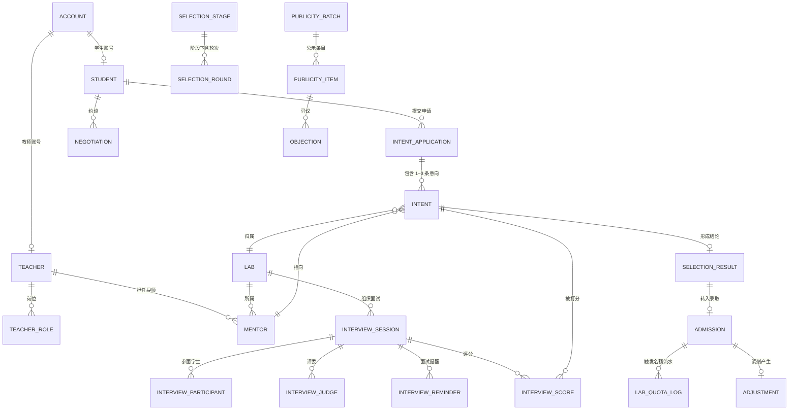

# 实训室选组选拔系统 数据库设计文档

> 版本：v1.0　依据：《项目需求说明书》　数据库：MySQL 8.0+
> 设计原则：**主数据稳定、流程状态显式、名额可核对、全过程可追溯**

---

## 一、设计约定

| 项目 | 约定 |
|---|---|
| 数据库 | MySQL 8.0+，InnoDB，`utf8mb4` / `utf8mb4_0900_ai_ci` |
| 主键 | `BIGINT UNSIGNED AUTO_INCREMENT`，统一命名 `<表名>_id`（`account` 为 `account_id`） |
| 时间 | 统一 `DATETIME(3)`，以服务器时间为准 |
| 枚举 | 使用 `VARCHAR` 码值（大写），含义见第五章；不使用 MySQL `ENUM`，便于扩展 |
| 布尔 | `TINYINT(1)`，0/1 |
| 金额/分值 | `DECIMAL`，禁止浮点 |
| 逻辑删除 | 不设 `is_deleted`。核心业务数据只追加不删除，更正通过状态迁移 + 审计日志表达（BR-26） |
| 外键 | DDL 不强制外键约束，关系由应用层事务与索引保证（避免高并发下行锁放大）；ER 图表达逻辑关系 |
| 冗余字段 | 仅保留必要冗余（如 `intent.lab_id`、`student.selection_state`），由同一事务同步维护 |
| 命名 | 表名单数 snake_case；索引 `uk_` 唯一、`idx_` 普通 |

**分层**：主数据（账号/学生/老师/实训室/导师）→ 流程配置（阶段/轮次/评分方案）→ 过程数据（申请/意向/面试/评分/结论）→ 结果数据（录取/调剂/约谈）→ 公示与通知 → 审计。

---

## 二、表清单

| # | 表名 | 中文名 | 模块 | 主要写入方 |
|---|---|---|---|---|
| 1 | `account` | 登录账号 | 主数据 | 系统/管理员 |
| 2 | `student` | 学生 | 主数据 | 教务导入/学生完善 |
| 3 | `teacher` | 老师 | 主数据 | 教务导入 |
| 4 | `teacher_role` | 老师岗位（导师/负责人/统筹岗） | 主数据 | 统筹岗负责人 |
| 5 | `lab` | 实训室 | 主数据 | 实训室负责人 |
| 6 | `mentor` | 导师（含带人容量） | 主数据 | 实训室负责人 |
| 7 | `score_scheme` | 评分方案（维度权重/计分方式） | 配置 | 统筹岗负责人 |
| 8 | `selection_stage` | 选拔阶段（8 个阶段开关与时间窗） | 配置 | 统筹岗负责人 |
| 9 | `selection_round` | 选拔轮次（首轮/二轮/三轮/统筹调剂） | 配置 | 统筹岗负责人 |
| 10 | `intent_application` | 意向申请单（含两项调剂授权） | 填报 | 学生 |
| 11 | `intent` | 平行意向明细 | 填报 | 学生 |
| 12 | `interview_session` | 面试场次 | 面试 | 实训室负责人 |
| 13 | `interview_judge` | 场次评委 | 面试 | 实训室负责人 |
| 14 | `interview_participant` | 场次学生（签到） | 面试 | 系统/负责人 |
| 15 | `interview_score` | 面试评分（四维度） | 面试 | 导师 |
| 16 | `selection_result` | 选拔结论（拟录取/递补/内部候选/不录取） | 面试 | 实训室负责人 |
| 17 | `admission` | 录取记录（预占/确认/生效/入组） | 录取 | 系统/负责人 |
| 18 | `lab_quota_log` | 名额变动流水 | 录取 | 系统 |
| 19 | `adjustment` | 调剂记录（三级优先级） | 录取 | 统筹岗负责人 |
| 20 | `negotiation` | 约谈记录 | 录取 | 统筹岗负责人 |
| 21 | `publicity_batch` | 公示批次 | 公示 | 统筹岗负责人 |
| 22 | `publicity_item` | 公示条目 | 公示 | 统筹岗负责人 |
| 23 | `objection` | 公示异议 | 公示 | 学生/负责人 |
| 24 | `notification` | 站内通知 | 支撑 | 系统 |
| 25 | `audit_log` | 审计日志 | 支撑 | 系统 |
| 26 | `open_day_reservation` | 开放日预约/走访记录（可选） | 支撑 | 学生 |
| 27 | `interview_reminder` | 面试提醒记录（生成/送达/回执） | 面试 | 系统/实训室负责人 |

---

## 三、ER 图



**关系要点**

- 一个账号只能对应一个学生或一个老师（`account_id` 唯一）。
- 一名老师可在 `teacher_role` 中拥有多个岗位：`MENTOR`（导师）、`LAB_OWNER`（实训室负责人，绑定实训室）、`COORDINATOR`（全院统筹岗，`scope_lab_id=0`）。
- 一名学生每轮只有 1 张申请单（`uk_application_round_student`），申请单下挂 1~3 条意向（首轮），补录轮次为 1 条。
- 一条意向对应一次面试和多条评分；面试结论写入 `selection_result`；录取写入 `admission`。
- 一个学生同一时刻最多只能有一条"活跃"录取记录（数据库唯一索引强约束）。

---

## 四、表结构明细

### 4.1 account　登录账号

| 字段 | 类型 | 必填 | 说明 |
|---|---|---|---|
| account_id | BIGINT UNSIGNED | 是 | 主键 |
| user_no | VARCHAR(32) | 是 | 学号/工号，唯一 |
| user_type | VARCHAR(16) | 是 | `STUDENT` / `TEACHER` |
| login_name | VARCHAR(64) | 是 | 登录名，唯一 |
| password_hash | VARCHAR(128) | 是 | 密码摘要 |
| status | VARCHAR(16) | 是 | `ACTIVE` / `DISABLED` |
| created_at / updated_at | DATETIME(3) | 是 | 创建/更新时间 |

索引：`uk_account_user_no(user_no)`、`uk_account_login_name(login_name)`。

### 4.2 student　学生

| 字段 | 类型 | 必填 | 说明 |
|---|---|---|---|
| student_id | BIGINT UNSIGNED | 是 | 主键 |
| account_id | BIGINT UNSIGNED | 是 | 关联账号，唯一 |
| student_no | VARCHAR(32) | 是 | 学号，唯一 |
| name | VARCHAR(50) | 是 | 姓名 |
| gender | VARCHAR(8) | 否 | 性别 |
| grade | VARCHAR(16) | 否 | 年级 |
| major | VARCHAR(64) | 否 | 专业 |
| college | VARCHAR(64) | 否 | 学院 |
| programming_base | VARCHAR(32) | 否 | 编程基础：`NONE`/`BASIC`/`GOOD` |
| available_hours | DECIMAL(4,1) | 否 | 每周可投入小时 |
| phone / email | VARCHAR(32/64) | 否 | 联系方式 |
| grade_rank | VARCHAR(32) | 否 | 年级排名（如 `3/120`；学生自助注册时必填，历史导入数据可为空） |
| awards | VARCHAR(500) | 否 | 获奖情况（个人简历） |
| specialty | VARCHAR(200) | 否 | 擅长方向（个人简历） |
| dev_direction | VARCHAR(200) | 否 | 意向发展方向（个人简历，与擅长方向同栏填写） |
| selection_state | VARCHAR(32) | 是 | 选拔状态汇总，见 5.5，默认 `NOT_FILLED` |
| created_at / updated_at | DATETIME(3) | 是 | 时间 |

索引：`uk_student_no(student_no)`、`uk_student_account(account_id)`、`idx_student_state(selection_state)`。

> `selection_state` 是流程汇总字段，由各阶段事务同步维护，不作为唯一事实来源；事实以 `intent`、`admission` 为准。

### 4.3 teacher　老师

| 字段 | 类型 | 必填 | 说明 |
|---|---|---|---|
| teacher_id | BIGINT UNSIGNED | 是 | 主键 |
| account_id | BIGINT UNSIGNED | 是 | 关联账号，唯一 |
| teacher_no | VARCHAR(32) | 是 | 工号，唯一 |
| name | VARCHAR(50) | 是 | 姓名 |
| college | VARCHAR(64) | 否 | 所属学院 |
| title | VARCHAR(32) | 否 | 职称 |
| intro | VARCHAR(500) | 否 | 个人简介（教师本人可维护，BR-44） |
| phone / email | VARCHAR(32/64) | 否 | 联系方式 |
| status | VARCHAR(16) | 是 | `ACTIVE` / `DISABLED` |
| created_at / updated_at | DATETIME(3) | 是 | 时间 |

### 4.4 teacher_role　老师岗位

| 字段 | 类型 | 必填 | 说明 |
|---|---|---|---|
| role_id | BIGINT UNSIGNED | 是 | 主键 |
| teacher_id | BIGINT UNSIGNED | 是 | 老师 |
| role_code | VARCHAR(16) | 是 | `MENTOR` 导师 / `LAB_OWNER` 实训室负责人 / `COORDINATOR` 全院统筹岗 |
| scope_lab_id | BIGINT UNSIGNED | 是 | 作用范围实训室；统筹岗固定填 0 |
| status | VARCHAR(16) | 是 | `ACTIVE` / `REVOKED` |
| granted_by / granted_at | BIGINT UNSIGNED / DATETIME(3) | 是 | 授权人与时间 |

索引：`uk_teacher_role(teacher_id, role_code, scope_lab_id)`、`idx_role_lab(scope_lab_id, role_code, status)`。

### 4.5 lab　实训室

| 字段 | 类型 | 必填 | 说明 |
|---|---|---|---|
| lab_id | BIGINT UNSIGNED | 是 | 主键 |
| lab_code | VARCHAR(32) | 是 | 实训室编号，唯一 |
| name | VARCHAR(64) | 是 | 名称 |
| college | VARCHAR(64) | 否 | 所属学院 |
| direction | VARCHAR(255) | 否 | 主要方向 |
| intro | VARCHAR(1000) | 否 | 实训室简介（负责人可维护，BR-44） |
| quota | INT | 是 | 招录名额（BR-16 的硬上限） |
| training_plan | TEXT | 否 | 培养安排 |
| assessment_requirement | TEXT | 否 | 考核要求 |
| status | VARCHAR(16) | 是 | `DRAFT` / `OPEN` / `CLOSED` |
| created_at / updated_at | DATETIME(3) | 是 | 时间 |

索引：`uk_lab_code(lab_code)`、`idx_lab_status(status)`。

### 4.6 mentor　导师

| 字段 | 类型 | 必填 | 说明 |
|---|---|---|---|
| mentor_id | BIGINT UNSIGNED | 是 | 主键 |
| teacher_id | BIGINT UNSIGNED | 是 | 关联老师 |
| lab_id | BIGINT UNSIGNED | 是 | 所属实训室 |
| research_direction | VARCHAR(255) | 否 | 研究方向 |
| capacity | INT | 否 | 可带人数（软约束，用于提示；硬约束为 `lab.quota`） |
| status | VARCHAR(16) | 是 | `ACTIVE` / `INACTIVE` |
| created_at / updated_at | DATETIME(3) | 是 | 时间 |

索引：`uk_mentor_teacher_lab(teacher_id, lab_id)`、`idx_mentor_lab(lab_id, status)`。

### 4.7 score_scheme　评分方案

| 字段 | 类型 | 必填 | 说明 |
|---|---|---|---|
| scheme_id | BIGINT UNSIGNED | 是 | 主键 |
| scheme_name | VARCHAR(64) | 是 | 方案名 |
| round_type | VARCHAR(16) | 否 | 适用轮次；`NULL` 表示全局方案 |
| learning_weight | DECIMAL(5,2) | 是 | 学习态度权重 |
| logic_weight | DECIMAL(5,2) | 是 | 逻辑思维权重 |
| programming_weight | DECIMAL(5,2) | 是 | 编程基础权重 |
| time_weight | DECIMAL(5,2) | 是 | 时间投入权重 |
| min_score / max_score | DECIMAL(5,2) | 是 | 单维度分值区间（0–100） |
| judge_count_min | TINYINT | 是 | 单场最少评委数 |
| calc_mode | VARCHAR(16) | 是 | `AVG` 平均 / `TRIM_AVG` 去极值平均 / `WEIGHTED` 加权 |
| status | VARCHAR(16) | 是 | `ACTIVE` / `INACTIVE` |
| effective_from | DATETIME(3) | 否 | 生效时间 |

> 对应《需求说明书》第九章待确认项，把计分规则参数化，规则定稿后只需配置数据。

### 4.8 selection_stage　选拔阶段

| 字段 | 类型 | 必填 | 说明 |
|---|---|---|---|
| stage_id | BIGINT UNSIGNED | 是 | 主键 |
| stage_no | TINYINT | 是 | 1~8 |
| stage_code | VARCHAR(32) | 是 | `BRIEFING`/`OPEN_DAY`/`INTENT`/`INTERVIEW`/`CONFIRM`/`SUPPLEMENT`/`ADJUST`/`PUBLICITY` |
| stage_name | VARCHAR(64) | 是 | 阶段名称 |
| start_time / end_time | DATETIME(3) | 是 | 时间窗（BR-01） |
| status | VARCHAR(16) | 是 | `PLANNED` / `OPEN` / `CLOSED` / `EARLY_CLOSED` |
| opened_by / opened_at | BIGINT UNSIGNED / DATETIME(3) | 否 | 实际开启人与时间 |
| closed_by / closed_at | BIGINT UNSIGNED / DATETIME(3) | 否 | 实际关闭人与时间 |
| remark | VARCHAR(255) | 否 | 提前开/关原因（BR-02） |

索引：`uk_stage_no(stage_no)`、`idx_stage_time(start_time, end_time)`。

### 4.9 selection_round　选拔轮次

| 字段 | 类型 | 必填 | 说明 |
|---|---|---|---|
| round_id | BIGINT UNSIGNED | 是 | 主键 |
| round_no | TINYINT | 是 | 1 首轮 / 2 第二轮 / 3 第三轮 / 4 统筹调剂 |
| round_type | VARCHAR(16) | 是 | `FIRST` / `SECOND` / `THIRD` / `ADJUST` |
| round_name | VARCHAR(64) | 是 | 轮次名称 |
| intent_limit | TINYINT | 是 | 意向上限：首轮 3，补录 1（BR-04/BR-18） |
| fill_start / fill_end | DATETIME(3) | 是 | 填报窗口 |
| interview_start / interview_end | DATETIME(3) | 是 | 面试窗口 |
| confirm_start / confirm_end | DATETIME(3) | 是 | 确认窗口 |
| status | VARCHAR(16) | 是 | `PLANNED`/`FILLING`/`INTERVIEWING`/`CONFIRMING`/`CLOSED` |
| created_at / updated_at | DATETIME(3) | 是 | 时间 |

索引：`uk_round_no(round_no)`。

### 4.10 intent_application　意向申请单

| 字段 | 类型 | 必填 | 说明 |
|---|---|---|---|
| application_id | BIGINT UNSIGNED | 是 | 主键 |
| round_id | BIGINT UNSIGNED | 是 | 轮次 |
| student_id | BIGINT UNSIGNED | 是 | 学生 |
| accept_internal_adjust | TINYINT(1) | 是 | 服从实训室内部调剂，默认 0（BR-06） |
| accept_cross_adjust | TINYINT(1) | 是 | 服从全院跨实训室调剂，默认 0 |
| intent_count | TINYINT | 是 | 已填意向数，默认 0，提交时校验 ≤ `intent_limit` |
| status | VARCHAR(16) | 是 | `DRAFT` / `SUBMITTED`（提交即锁定，BR-07） |
| submitted_at | DATETIME(3) | 否 | 提交时间 |
| created_at / updated_at | DATETIME(3) | 是 | 时间 |

索引：`uk_application_round_student(round_id, student_id)`、`idx_application_student(student_id)`。

### 4.11 intent　平行意向

| 字段 | 类型 | 必填 | 说明 |
|---|---|---|---|
| intent_id | BIGINT UNSIGNED | 是 | 主键 |
| application_id | BIGINT UNSIGNED | 是 | 所属申请单 |
| round_id | BIGINT UNSIGNED | 是 | 轮次（冗余，便于按轮查询） |
| student_id | BIGINT UNSIGNED | 是 | 学生（冗余） |
| mentor_id | BIGINT UNSIGNED | 是 | 意向导师 |
| lab_id | BIGINT UNSIGNED | 是 | 所属实训室（冗余，必须与导师一致） |
| parallel_no | TINYINT | 是 | 平行序号 1~3；补录固定 1 |
| status | VARCHAR(32) | 是 | 见 5.2，默认 `DRAFT` |
| submitted_at | DATETIME(3) | 否 | 提交时间 |
| created_at / updated_at | DATETIME(3) | 是 | 时间 |

索引：
- `uk_intent_app_parallel(application_id, parallel_no)`
- `uk_intent_app_mentor(application_id, mentor_id)` ← BR-05 去重
- `idx_intent_lab_status(lab_id, status)` ← 实训室报名汇总
- `idx_intent_student_round(student_id, round_id, status)`
- `idx_intent_mentor(mentor_id)`

### 4.12 interview_session　面试场次

| 字段 | 类型 | 必填 | 说明 |
|---|---|---|---|
| session_id | BIGINT UNSIGNED | 是 | 主键 |
| round_id | BIGINT UNSIGNED | 是 | 轮次 |
| lab_id | BIGINT UNSIGNED | 是 | 实训室（BR-09 统一组织） |
| session_name | VARCHAR(64) | 否 | 场次名称 |
| start_time / end_time | DATETIME(3) | 是 | 起止时间 |
| location | VARCHAR(128) | 否 | 地点 |
| organizer_teacher_id | BIGINT UNSIGNED | 是 | 组织人（负责人） |
| status | VARCHAR(16) | 是 | `PLANNED`/`ONGOING`/`FINISHED`/`CANCELED` |
| remark | VARCHAR(255) | 否 | 备注 |
| created_at / updated_at | DATETIME(3) | 是 | 时间 |

索引：`idx_session_lab_round(lab_id, round_id, status)`、`idx_session_time(start_time)`。

### 4.13 interview_judge　场次评委

| 字段 | 类型 | 必填 | 说明 |
|---|---|---|---|
| judge_id | BIGINT UNSIGNED | 是 | 主键 |
| session_id | BIGINT UNSIGNED | 是 | 场次 |
| teacher_id | BIGINT UNSIGNED | 是 | 评委老师 |
| judge_role | VARCHAR(16) | 是 | `CHAIR` 主评委 / `JUDGE` 评委 |
| created_at | DATETIME(3) | 是 | 时间 |

索引：`uk_judge_session_teacher(session_id, teacher_id)`。

### 4.14 interview_participant　场次学生

| 字段 | 类型 | 必填 | 说明 |
|---|---|---|---|
| participant_id | BIGINT UNSIGNED | 是 | 主键 |
| session_id | BIGINT UNSIGNED | 是 | 场次 |
| intent_id | BIGINT UNSIGNED | 是 | 对应意向 |
| student_id | BIGINT UNSIGNED | 是 | 学生 |
| checkin_status | VARCHAR(16) | 是 | `NOT_CHECKED_IN` / `CHECKED_IN` / `ABSENT` |
| checkin_at | DATETIME(3) | 否 | 签到时间 |
| created_at / updated_at | DATETIME(3) | 是 | 时间 |

索引：`uk_participant_session_intent(session_id, intent_id)`、`idx_participant_intent(intent_id)`、`idx_participant_student(session_id, student_id)`。

> BR-08：每条 `SUBMITTED` 意向都必须存在对应的参面记录，缺记录即视为"未安排面试"，阻断进入定名单。

### 4.15 interview_score　面试评分

| 字段 | 类型 | 必填 | 说明 |
|---|---|---|---|
| score_id | BIGINT UNSIGNED | 是 | 主键 |
| session_id | BIGINT UNSIGNED | 是 | 场次 |
| intent_id | BIGINT UNSIGNED | 是 | 意向 |
| student_id | BIGINT UNSIGNED | 是 | 学生（冗余） |
| judge_teacher_id | BIGINT UNSIGNED | 是 | 打分评委 |
| learning_score | DECIMAL(5,2) | 是 | 学习态度 |
| logic_score | DECIMAL(5,2) | 是 | 逻辑思维 |
| programming_score | DECIMAL(5,2) | 是 | 编程基础 |
| time_score | DECIMAL(5,2) | 是 | 时间投入 |
| total_score | DECIMAL(5,2) | 是 | 按方案计算的个人总分 |
| comment | VARCHAR(1000) | 否 | 评语 |
| status | VARCHAR(16) | 是 | `DRAFT` / `SUBMITTED` |
| submitted_at | DATETIME(3) | 否 | 提交时间 |
| created_at / updated_at | DATETIME(3) | 是 | 时间 |

索引：`uk_score_session_intent_judge(session_id, intent_id, judge_teacher_id)`、`idx_score_intent(intent_id)`、`idx_score_student(student_id)`。

### 4.16 selection_result　选拔结论

| 字段 | 类型 | 必填 | 说明 |
|---|---|---|---|
| result_id | BIGINT UNSIGNED | 是 | 主键 |
| round_id | BIGINT UNSIGNED | 是 | 轮次 |
| lab_id | BIGINT UNSIGNED | 是 | 实训室 |
| student_id | BIGINT UNSIGNED | 是 | 学生 |
| intent_id | BIGINT UNSIGNED | 否 | 意向；统筹调剂的学生可能无有效意向，可为空 |
| list_type | VARCHAR(24) | 是 | `PROPOSED` 拟录取 / `WAITLIST` 递补 / `INTERNAL_CANDIDATE` 内部调剂候选 / `REJECTED` 不录取 |
| rank_no | INT | 否 | 顺位（递补名单必须有序） |
| score | DECIMAL(5,2) | 否 | 汇总得分（多评委按方案计算） |
| generated_by | BIGINT UNSIGNED | 是 | 生成人 |
| generated_at | DATETIME(3) | 是 | 生成时间 |
| remark | VARCHAR(255) | 否 | 备注 |

索引：`uk_result_round_lab_student_list(round_id, lab_id, student_id, list_type)`、`idx_result_rank(round_id, lab_id, list_type, rank_no)`。

> BR-11 名单三件套由 `list_type` 承载，`rank_no` 承载递补顺位。

### 4.17 admission　录取记录

| 字段 | 类型 | 必填 | 说明 |
|---|---|---|---|
| admission_id | BIGINT UNSIGNED | 是 | 主键 |
| student_id | BIGINT UNSIGNED | 是 | 学生 |
| lab_id | BIGINT UNSIGNED | 是 | 实训室 |
| mentor_id | BIGINT UNSIGNED | 是 | 导师 |
| round_id | BIGINT UNSIGNED | 是 | 来源轮次 |
| source_type | VARCHAR(24) | 是 | `ROUND1`/`ROUND2`/`ROUND3`/`ADJUST_INTERNAL`/`ADJUST_CROSS`/`NEGOTIATED` |
| confirm_type | VARCHAR(8) | 是 | `AUTO`（BR-13 单意向自动确认）/ `MANUAL`（BR-14 学生自主选择） |
| status | VARCHAR(16) | 是 | `OCCUPIED` 预占 / `CONFIRMED` 已确认 / `EFFECTIVE` 公示生效 / `ENROLLED` 已入组 / `ABANDONED` 已放弃 / `RELEASED` 已释放 |
| occupied_at | DATETIME(3) | 是 | 拟录预占时间 |
| confirm_deadline | DATETIME(3) | 否 | 确认截止（BR-14 按拟录时间 +12 小时生成） |
| confirmed_at | DATETIME(3) | 否 | 确认时间 |
| released_at | DATETIME(3) | 否 | 释放时间 |
| reason | VARCHAR(500) | 否 | 放弃/释放原因 |
| active_student_id | BIGINT UNSIGNED 生成列 | - | 已确认录取的学生 ID；`OCCUPIED` 待确认阶段为 NULL（允许同时存在多条待确认拟录取） |
| created_at / updated_at | DATETIME(3) | 是 | 时间 |

索引：
- `uk_admission_active_student(active_student_id)` ← **一个学生最多一条已确认录取**（BR-13/14）；`OCCUPIED` 不参与，故可同时持有多个待确认拟录取，由学生最终择一确认
- `idx_admission_lab_status(lab_id, status)` ← 名额占用计数（BR-16）
- `idx_admission_student(student_id)`
- `idx_admission_round(round_id)`

> `active_student_id` 定义：`CASE WHEN status IN ('CONFIRMED','EFFECTIVE','ENROLLED') THEN student_id END`，`STORED` 生成列 + 唯一索引，从数据库层面杜绝"一人多录"（已确认口径）；待确认的 `OCCUPIED` 记录不占用该唯一约束。

### 4.18 lab_quota_log　名额变动流水

| 字段 | 类型 | 必填 | 说明 |
|---|---|---|---|
| log_id | BIGINT UNSIGNED | 是 | 主键 |
| lab_id | BIGINT UNSIGNED | 是 | 实训室 |
| round_id | BIGINT UNSIGNED | 是 | 轮次 |
| change_type | VARCHAR(16) | 是 | `OCCUPY` 预占 / `RELEASE` 释放 / `ADJUST_IN` 调剂进 / `ADJUST_OUT` 调剂出 |
| delta | TINYINT | 是 | +1 / -1 |
| active_count_before / active_count_after | INT | 是 | 变更前后活跃占用数 |
| admission_id | BIGINT UNSIGNED | 否 | 关联录取记录 |
| operator_id | BIGINT UNSIGNED | 否 | 操作人（系统操作记为 0） |
| remark | VARCHAR(255) | 否 | 说明 |
| created_at | DATETIME(3) | 是 | 时间 |

索引：`idx_quota_lab_round(lab_id, round_id, created_at)`、`idx_quota_admission(admission_id)`。

### 4.19 adjustment　调剂记录

| 字段 | 类型 | 必填 | 说明 |
|---|---|---|---|
| adjust_id | BIGINT UNSIGNED | 是 | 主键 |
| round_id | BIGINT UNSIGNED | 是 | 轮次（统筹调剂轮） |
| student_id | BIGINT UNSIGNED | 是 | 学生 |
| priority_level | TINYINT | 是 | 1 内部调剂 / 2 全院跨室调剂 / 3 约谈后统筹安置（BR-20） |
| adjust_type | VARCHAR(16) | 是 | `INTERNAL` / `CROSS` / `NEGOTIATED` |
| from_lab_id | BIGINT UNSIGNED | 否 | 原实训室 |
| to_lab_id | BIGINT UNSIGNED | 否 | 目标实训室 |
| to_mentor_id | BIGINT UNSIGNED | 否 | 目标导师 |
| status | VARCHAR(16) | 是 | `PENDING` / `MATCHED` / `REJECTED` / `ABANDONED` |
| admission_id | BIGINT UNSIGNED | 否 | 匹配成功后生成的录取记录 |
| operator_id | BIGINT UNSIGNED | 是 | 处理人（系统自动匹配记 0） |
| decided_at | DATETIME(3) | 否 | 处理时间 |
| remark | VARCHAR(500) | 否 | 说明 |
| created_at / updated_at | DATETIME(3) | 是 | 时间 |

索引：`idx_adjust_student(student_id)`、`idx_adjust_to_lab(to_lab_id, status)`、`idx_adjust_priority(round_id, priority_level, status)`。

### 4.20 negotiation　约谈记录

| 字段 | 类型 | 必填 | 说明 |
|---|---|---|---|
| negotiation_id | BIGINT UNSIGNED | 是 | 主键 |
| round_id | BIGINT UNSIGNED | 是 | 轮次（统筹调剂轮） |
| student_id | BIGINT UNSIGNED | 是 | 学生 |
| interviewer_teacher_id | BIGINT UNSIGNED | 是 | 约谈人 |
| negotiate_time | DATETIME(3) | 是 | 约谈时间 |
| method | VARCHAR(16) | 是 | `FACE_TO_FACE` / `PHONE` / `ONLINE` |
| willingness | VARCHAR(500) | 否 | 学生意愿记录 |
| conclusion | VARCHAR(16) | 是 | `ACCEPT` 接受安置 / `REJECT` 拒绝安置 |
| final_lab_id | BIGINT UNSIGNED | 否 | 最终安置实训室 |
| final_mentor_id | BIGINT UNSIGNED | 否 | 最终导师 |
| admission_id | BIGINT UNSIGNED | 否 | 对应录取记录 |
| remark | VARCHAR(500) | 否 | 补充说明 |
| recorded_at | DATETIME(3) | 是 | 记录时间 |
| created_at | DATETIME(3) | 是 | 时间 |

索引：`idx_negotiation_round_student(round_id, student_id)`（允许同一学生同一轮次多次约谈，故不设唯一约束）、`idx_negotiation_student(student_id)`。

> BR-23：`conclusion`、`interviewer_teacher_id`、`negotiate_time` 均为必填，未登记不得视为完成安置。

### 4.21 publicity_batch　公示批次

| 字段 | 类型 | 必填 | 说明 |
|---|---|---|---|
| batch_id | BIGINT UNSIGNED | 是 | 主键 |
| round_id | BIGINT UNSIGNED | 否 | 关联轮次 |
| batch_no | VARCHAR(32) | 是 | 批次号，唯一 |
| start_time / end_time | DATETIME(3) | 是 | 公示起止（BR-24，公示 1 天） |
| status | VARCHAR(16) | 是 | `PUBLISHING` / `FINISHED` / `EFFECTIVE` |
| published_by / published_at | BIGINT UNSIGNED / DATETIME(3) | 是 | 发布人与时间 |
| remark | VARCHAR(255) | 否 | 备注 |
| created_at / updated_at | DATETIME(3) | 是 | 时间 |

### 4.22 publicity_item　公示条目

| 字段 | 类型 | 必填 | 说明 |
|---|---|---|---|
| item_id | BIGINT UNSIGNED | 是 | 主键 |
| batch_id | BIGINT UNSIGNED | 是 | 批次 |
| student_id | BIGINT UNSIGNED | 是 | 学生 |
| lab_id | BIGINT UNSIGNED | 是 | 实训室 |
| mentor_id | BIGINT UNSIGNED | 是 | 导师 |
| admission_id | BIGINT UNSIGNED | 是 | 录取记录 |
| item_status | VARCHAR(16) | 是 | `NORMAL` / `SUSPENDED`（异议挂起）/ `REVOKED` |
| created_at / updated_at | DATETIME(3) | 是 | 时间 |

索引：`uk_publicity_item_batch_student(batch_id, student_id)`、`idx_publicity_item_lab(batch_id, lab_id)`。

### 4.23 objection　公示异议

| 字段 | 类型 | 必填 | 说明 |
|---|---|---|---|
| objection_id | BIGINT UNSIGNED | 是 | 主键 |
| batch_id | BIGINT UNSIGNED | 是 | 批次 |
| publicity_item_id | BIGINT UNSIGNED | 否 | 关联条目 |
| student_id | BIGINT UNSIGNED | 是 | 提出人 |
| content | VARCHAR(1000) | 是 | 异议内容 |
| status | VARCHAR(16) | 是 | `PENDING` / `PROCESSING` / `RESOLVED` / `REJECTED` |
| handled_by | BIGINT UNSIGNED | 否 | 处理人 |
| handled_at | DATETIME(3) | 否 | 处理时间 |
| resolution | VARCHAR(1000) | 否 | 处理结论 |
| created_at / updated_at | DATETIME(3) | 是 | 时间 |

索引：`idx_objection_batch_status(batch_id, status)`、`idx_objection_student(student_id)`。

### 4.24 notification　站内通知

| 字段 | 类型 | 必填 | 说明 |
|---|---|---|---|
| notice_id | BIGINT UNSIGNED | 是 | 主键 |
| receiver_account_id | BIGINT UNSIGNED | 是 | 接收账号 |
| notice_type | VARCHAR(32) | 是 | `STAGE_OPEN`/`STAGE_CLOSE`/`INTERVIEW`/`PROPOSAL`/`CONFIRM_REMIND`/`SUPPLEMENT`/`NEGOTIATION`/`PUBLICITY` |
| title | VARCHAR(120) | 是 | 标题 |
| content | VARCHAR(1000) | 否 | 正文 |
| biz_type / biz_id | VARCHAR(32) / BIGINT UNSIGNED | 否 | 关联业务 |
| read_flag | TINYINT(1) | 是 | 已读标记，默认 0 |
| sent_at | DATETIME(3) | 是 | 发送时间 |
| read_at | DATETIME(3) | 否 | 阅读时间 |
| created_at | DATETIME(3) | 是 | 时间 |

索引：`idx_notice_receiver(receiver_account_id, read_flag, sent_at)`。

### 4.25 audit_log　审计日志

| 字段 | 类型 | 必填 | 说明 |
|---|---|---|---|
| log_id | BIGINT UNSIGNED | 是 | 主键 |
| operator_account_id | BIGINT UNSIGNED | 是 | 操作账号 |
| operator_role | VARCHAR(16) | 否 | 操作角色快照 |
| action_code | VARCHAR(48) | 是 | 动作码（见 5.9） |
| biz_type | VARCHAR(32) | 是 | 业务类型（表名或对象名） |
| biz_id | BIGINT UNSIGNED | 否 | 业务主键 |
| before_value / after_value | JSON | 否 | 变更前后快照 |
| ip | VARCHAR(45) | 否 | 来源 IP |
| user_agent | VARCHAR(255) | 否 | 终端信息 |
| created_at | DATETIME(3) | 是 | 时间 |

索引：`idx_audit_biz(biz_type, biz_id, created_at)`、`idx_audit_operator(operator_account_id, created_at)`、`idx_audit_action(action_code, created_at)`。

> 仅允许 `INSERT`，不提供 `UPDATE`/`DELETE` 权限；按月归档（BR-26）。

### 4.26 open_day_reservation　开放日预约（可选）

| 字段 | 类型 | 必填 | 说明 |
|---|---|---|---|
| reservation_id | BIGINT UNSIGNED | 是 | 主键 |
| student_id | BIGINT UNSIGNED | 是 | 学生 |
| lab_id | BIGINT UNSIGNED | 是 | 实训室 |
| visit_date | DATE | 是 | 走访日期 |
| time_slot | VARCHAR(16) | 是 | 时段 |
| status | VARCHAR(16) | 是 | `RESERVED` / `CHECKED_IN` / `CANCELED` |
| remark | VARCHAR(255) | 否 | 备注 |
| created_at / updated_at | DATETIME(3) | 是 | 时间 |

索引：`uk_reservation_student_lab_slot(student_id, lab_id, visit_date, time_slot)`。

### 4.27 interview_reminder　面试提醒记录

| 字段 | 类型 | 必填 | 说明 |
|---|---|---|---|
| reminder_id | BIGINT UNSIGNED | 是 | 主键 |
| session_id | BIGINT UNSIGNED | 是 | 面试场次 |
| intent_id | BIGINT UNSIGNED | 是 | 对应意向 |
| participant_id | BIGINT UNSIGNED | 是 | 对应参面记录 |
| student_id | BIGINT UNSIGNED | 是 | 学生（冗余） |
| offset_minutes | INT | 是 | 提前分钟数：1440（前 1 天）/ 120（前 2 小时） |
| remind_at | DATETIME(3) | 是 | 计划提醒时间 = 场次开始时间 − offset |
| channel | VARCHAR(16) | 是 | `SITE` 站内 / `SMS` 短信 / `WECHAT` 企业微信 |
| send_status | VARCHAR(16) | 是 | `PENDING` 待发 / `SENT` 已发 / `FAILED` 发送失败 / `CANCELED` 已取消 |
| retry_count | TINYINT | 是 | 重试次数，默认 0 |
| fail_reason | VARCHAR(255) | 否 | 失败原因 |
| sent_at | DATETIME(3) | 否 | 实际发送时间 |
| read_at | DATETIME(3) | 否 | 学生阅读时间 |
| ack_at | DATETIME(3) | 否 | 回执"已知晓"时间 |
| created_at / updated_at | DATETIME(3) | 是 | 时间 |

索引：
- `uk_reminder_session_intent_offset(session_id, intent_id, offset_minutes)` ← 同一场次同一意向同一时点只生成一条（同一学生多意向可各自生成）
- `idx_reminder_dispatch(send_status, remind_at)` ← 定时发送任务扫描
- `idx_reminder_student(student_id)`

> BR-28/29：场次排定后按 `offset_minutes` 批量生成提醒；发送失败累加 `retry_count` 并记录 `fail_reason`；`ack_at` 为学生回执时间，未签到由 `interview_participant.checkin_status` 标记缺席。

---

## 五、枚举字典

### 5.1 账号与角色
`account.user_type`: `STUDENT` / `TEACHER`
`teacher_role.role_code`: `MENTOR` 导师 / `LAB_OWNER` 实训室负责人 / `COORDINATOR` 全院统筹岗

### 5.2 意向状态（BR-07）
`DRAFT` 草稿 → `SUBMITTED` 已提交（锁定，不可撤回）→ `INTERVIEWED` 已面试 → `PROPOSED` 拟录取 / `WAITLIST` 递补 / `INTERNAL_CANDIDATE` 内部调剂候选 / `REJECTED` 不录取 → `CONFIRMED` 已确认 / `ABANDONED` 已放弃 / `INVALID` 已失效（多意向中未被选中）

> 迁移只允许向前：`DRAFT → SUBMITTED` 后不得回到 `DRAFT`；`INVALID` 仅由确认动作触发。

### 5.3 名单类型（BR-11）
`PROPOSED` 拟录取（≤ `lab.quota`）/ `WAITLIST` 递补（`rank_no` 有序）/ `INTERNAL_CANDIDATE` 内部调剂候选 / `REJECTED` 不录取

### 5.4 录取状态（BR-13~16）
| 状态 | 含义 | 是否计入名额 |
|---|---|---|
| OCCUPIED | 拟录取预占，待学生确认 | 是 |
| CONFIRMED | 已确认 | 是 |
| EFFECTIVE | 公示生效 | 是 |
| ENROLLED | 已正式入组 | 是 |
| ABANDONED | 逾期/主动放弃 | 否 |
| RELEASED | 已释放回名额池 | 否 |

### 5.5 学生选拔状态汇总
`NOT_FILLED` 未填报 / `PENDING_INTERVIEW` 待面试 / `PENDING_CONFIRM` 待确认 / `PROPOSED` 拟录取待公示 / `ENROLLED` 已入组 / `NOT_ADMITTED` 未录取 / `SUPPLEMENT` 补录中 / `PENDING_NEGOTIATION` 待约谈

### 5.6 轮次与阶段
`selection_round.round_type`: `FIRST` / `SECOND` / `THIRD` / `ADJUST`
`selection_stage.stage_code`: `BRIEFING` / `OPEN_DAY` / `INTENT` / `INTERVIEW` / `CONFIRM` / `SUPPLEMENT` / `ADJUST` / `PUBLICITY`

### 5.7 面试
`checkin_status`: `NOT_CHECKED_IN` / `CHECKED_IN` / `ABSENT`
`judge_role`: `CHAIR` / `JUDGE`
`score_scheme.calc_mode`: `AVG` / `TRIM_AVG` / `WEIGHTED`
`interview_reminder.send_status`: `PENDING` / `SENT` / `FAILED` / `CANCELED`
`interview_reminder.channel`: `SITE` / `SMS` / `WECHAT`

### 5.8 调剂与约谈
`adjustment.priority_level`: 1 内部调剂 / 2 全院跨室调剂 / 3 约谈后统筹安置（BR-20）
`adjustment.adjust_type`: `INTERNAL` / `CROSS` / `NEGOTIATED`
`adjustment.status`: `PENDING` / `MATCHED` / `REJECTED` / `ABANDONED`
`negotiation.conclusion`: `ACCEPT` / `REJECT`（BR-23）
`negotiation.method`: `FACE_TO_FACE` / `PHONE` / `ONLINE`

### 5.9 公示与通知
`publicity_batch.status`: `PUBLISHING` / `FINISHED` / `EFFECTIVE`
`publicity_item.item_status`: `NORMAL` / `SUSPENDED` / `REVOKED`
`objection.status`: `PENDING` / `PROCESSING` / `RESOLVED` / `REJECTED`
`notification.notice_type`: `STAGE_OPEN` / `STAGE_CLOSE` / `INTERVIEW` / `INTERVIEW_REMIND` / `PROPOSAL` / `CONFIRM_REMIND` / `SUPPLEMENT` / `NEGOTIATION` / `PUBLICITY`
`audit_log.action_code`: `INTENT_SUBMIT` / `INTENT_LOCK` / `SCORE_SUBMIT` / `RESULT_GENERATE` / `ADMISSION_CONFIRM` / `ADMISSION_RELEASE` / `ADJUST_MATCH` / `NEGOTIATION_RECORD` / `PUBLICITY_PUBLISH` / `OBJECTION_HANDLE` / `STAGE_TOGGLE` / `CONFIG_CHANGE`

---

## 六、关键约束与实现方案

| 需求规则 | 数据库落点 | 实现方式 |
|---|---|---|
| BR-01 时间窗刚性 | `selection_stage.start_time/end_time`、`selection_round` 三组窗口 | 所有写接口前置校验 `NOW(3)` 落在窗口内且阶段 `OPEN`，否则拒绝 |
| BR-02 阶段不可跳跃 | `selection_stage.status` | 状态机校验；提前开/关写 `remark` 与 `opened_by/closed_by` |
| BR-03 截止即锁 | 同 BR-01 | 截止时间由库内时间判定，不信任客户端时间 |
| BR-04 / BR-18 意向上限 | `selection_round.intent_limit`（3 / 1）、`intent_application.intent_count` | 同一事务内 `SELECT ... FOR UPDATE` 锁申请单，`intent_count+1 ≤ intent_limit` 才允许插入 |
| BR-05 意向去重 | `uk_intent_app_mentor` | 唯一索引直接拦截重复导师 |
| BR-06 调剂授权分离 | `intent_application.accept_internal_adjust` / `accept_cross_adjust` | 两个字段独立，默认 0；未勾选即不授权 |
| BR-07 提交不可撤回 | `intent_application.status`、`intent.status`、`audit_log` | 更新语句带 `AND status='DRAFT'` 条件；提交后无任何回退路径；审计留痕 |
| BR-08 全员必面 | `interview_participant` | 生成名单前校验：每个 `SUBMITTED` 意向均存在参面记录，否则阻断 |
| BR-09 统一组织 | `interview_session.lab_id + organizer_teacher_id` | 场次必须挂在实训室，评委通过 `teacher_role.MENTOR/LAB_OWNER` 校验 |
| BR-10 统一维度 | `interview_score` 四个维度 + `score_scheme` 权重 | 维度字段固定；权重与计分方式按轮次取方案 |
| BR-11 名单三件套 | `selection_result.list_type` + `rank_no` | 拟录取/递补/内部候选分别落库，递补按 `rank_no` 排序 |
| BR-13 自动确认 | `admission.confirm_type='AUTO'` | 拟录生成时若仅 1 条 `PROPOSED`，事务内直接置 `CONFIRMED` |
| BR-14 多意向选择 | `uk_admission_active_student`、`intent.status='INVALID'` | 确认事务：目标录取置 `CONFIRMED`，其余录用置 `RELEASED`、意向置 `INVALID`；唯一索引保证只成一条 |
| BR-15 逾期放弃 | `admission.confirm_deadline` + 定时任务 | 扫描 `status='OCCUPIED' AND confirm_deadline < NOW(3)` → `ABANDONED` 并写 `lab_quota_log` |
| BR-16 名额硬约束 | `lab.quota` + `idx_admission_lab_status` | 事务内 `SELECT quota FROM lab WHERE lab_id=? FOR UPDATE`，再统计活跃录取数，超限回滚 |
| BR-17 补录资格 | `admission` 活跃记录 | 写补录申请前校验该生无活跃录取 |
| BR-19 调剂池 | `adjustment` + 各室剩余名额 | 统筹轮归集剩余名额，仅 `COORDINATOR` 可写 |
| BR-20 优先级顺序 | `adjustment.priority_level` | 按 1→2→3 依次执行，上一级未处理完不得生成下一级记录 |
| BR-21 调剂授权 | `intent_application` 两字段 | 内部调剂校验 `accept_internal_adjust=1`；跨室校验 `accept_cross_adjust=1` |
| BR-22 调剂占名额 | 同 BR-16 | 调剂录取同样走名额事务校验 |
| BR-23 约谈必录 | `negotiation.conclusion` 等 NOT NULL | 无约谈记录不得生成 `NEGOTIATED` 录取 |
| BR-24/25 公示入组 | `publicity_batch`、`publicity_item.item_status`、`objection.status` | 公示期满且该条目无 `PENDING/PROCESSING` 异议，才允许 `admission → ENROLLED` |
| BR-26 全链路留痕 | `audit_log`（JSON 前后值） | 应用层 AOP 统一写入；数据库账号仅授予 INSERT |
| BR-27 通知到人 | `notification` | 阶段开闭、拟录、截止提醒等事件落库并由推送任务消费 |
| BR-28 面试提醒时点与内容 | `interview_reminder.offset_minutes`、`remind_at` | 场次排定后按 1440 / 120 分钟批量生成提醒；定时任务扫描 `send_status='PENDING' AND remind_at <= NOW(3)` |
| BR-29 送达、回执与缺席 | `interview_reminder.send_status/retry_count/ack_at`、`interview_participant.checkin_status` | 发送失败累加重试并记录原因；学生可回执；未签到置 `ABSENT`，补面由负责人处理并留痕 |

**名额一致性示例逻辑（伪代码）**

```
BEGIN;
SELECT quota FROM lab WHERE lab_id = ? FOR UPDATE;          -- 行锁
SELECT COUNT(*) INTO used FROM admission
  WHERE lab_id = ? AND status IN ('OCCUPIED','CONFIRMED','EFFECTIVE','ENROLLED');
IF used + 1 > quota THEN ROLLBACK;                          -- BR-16
INSERT INTO admission (... status='OCCUPIED');
INSERT INTO lab_quota_log (... change_type='OCCUPY', delta=1, ...);
COMMIT;
```

**递补自动补位**

```sql
SELECT student_id, intent_id FROM selection_result
 WHERE round_id = ? AND lab_id = ? AND list_type = 'WAITLIST'
   AND student_id NOT IN (
       SELECT student_id FROM admission
        WHERE status IN ('OCCUPIED','CONFIRMED','EFFECTIVE','ENROLLED'))
 ORDER BY rank_no ASC
 LIMIT 1;
```

---

## 七、各阶段的写入路径

| 阶段 | 主要写表 | 关键校验 |
|---|---|---|
| 1 集中宣讲 | `selection_stage`、`lab`、`notification` | 仅统筹岗可发布 |
| 2 开放日 | `open_day_reservation`（可选） | 日期在阶段窗内 |
| 3 意向填报 | `intent_application`、`intent`、`audit_log` | 时间窗、意向 ≤3、导师不重复、提交锁定 |
| 4 面试考核 | `interview_session`、`interview_judge`、`interview_participant`、`interview_reminder`、`interview_score`、`selection_result` | 全员覆盖、评委数 ≥ `judge_count_min`、提醒按 1440/120 分钟生成、拟录取 ≤ 名额 |
| 5 拟录取确认 | `admission`、`lab_quota_log`、`intent`、`notification` | 单活跃录取、确认截止、放弃释放、递补补位 |
| 6 分轮补录 | `selection_round`、`intent_application`、`intent`、面试系列 | 仅未录取可填、每轮 1 条意向、轮次隔离 |
| 7 统筹调剂 | `adjustment`、`negotiation`、`admission`、`lab_quota_log` | 三级顺序、授权校验、约谈结论必填 |
| 8 公示入组 | `publicity_batch`、`publicity_item`、`objection`、`admission`、`student.selection_state`、`notification` | 公示满 1 天、无未决异议才置 `ENROLLED` |

---

## 八、索引与性能设计

1. **热点查询与索引**
   - 实训室报名汇总：`intent(lab_id, status)`。
   - 学生查询本人意向/结果：`intent(student_id, round_id, status)`、`admission(student_id)`。
   - 名额实时统计：`admission(lab_id, status)` 覆盖索引，配合 `lab` 行锁。
   - 递补取号：`selection_result(round_id, lab_id, list_type, rank_no)`。
   - 公示名单：`publicity_item(batch_id, lab_id)`。
   - 面试提醒派发：`interview_reminder(send_status, remind_at)`，定时任务按 `remind_at` 顺序扫描。
   - 学生提醒查询：`interview_reminder(student_id)`。
2. **写入并发**：填报/确认窗口集中，事务保持短小；`intent_application` 与 `lab` 行锁按固定顺序获取，避免死锁。
3. **幂等**：申请单 `uk_application_round_student` + 前端幂等键，重复提交返回首次结果。
4. **定时任务**：
   - 逾期未确认扫描（`admission.status='OCCUPIED' AND confirm_deadline < NOW(3)`），建议 `LIMIT` 分批 + `FOR UPDATE SKIP LOCKED`。
   - 面试提醒派发（`interview_reminder.send_status='PENDING' AND remind_at <= NOW(3)`），失败重试并累计 `retry_count`。
   - 公示到期转 `EFFECTIVE` 并触发入组。
   - 阶段开闭到点提醒（基于 `selection_stage`）。
5. **归档**：`audit_log`、`notification` 按年/月归档或分区；业务表不物理删除。
6. **容量估算**（按 2000 名学生、单届 1 轮首轮 + 2 轮补录 + 1 轮统筹）：

| 表 | 预估行数/届 |
|---|---|
| intent_application | ≈ 2000 × 4 轮 ≈ 8000 |
| intent | ≈ 首轮 3× + 补录 1× ≈ 8000~10000 |
| interview_score | ≈ 意向数 × 2 评委 ≈ 20000 |
| interview_reminder | ≈ 意向数 × 2 个提醒时点 ≈ 20000 |
| selection_result | ≈ 意向数 ≈ 10000 |
| admission / quota_log | 数千 |
| audit_log | 十万级（建议归档） |

整体规模小，单库即可；无需分库分表。

---

## 九、需求对象与表映射

| 需求对象 | 对应表 |
|---|---|
| 实训室 | `lab` |
| 导师 | `teacher` + `mentor` + `teacher_role` |
| 学生 | `account` + `student` |
| 意向记录 | `intent_application`（授权） + `intent`（明细） |
| 面试场次 | `interview_session` + `interview_judge` + `interview_participant` |
| 面试评分 | `interview_score` + `score_scheme` |
| 面试提醒 | `interview_reminder` + `notification`（`INTERVIEW_REMIND`） |
| 选拔结论 | `selection_result` |
| 录取记录 | `admission` + `lab_quota_log` |
| 约谈记录 | `negotiation` |
| 公示批次 | `publicity_batch` + `publicity_item` + `objection` |
| 阶段与轮次 | `selection_stage` + `selection_round` |
| 通知与留痕 | `notification` + `audit_log` |

---

## 十、附录：完整 DDL

```sql
-- =========================================================
-- 实训室选组选拔系统 DDL（MySQL 8.0+）
-- 说明：不强制外键，关系由应用层与索引保证
-- =========================================================

CREATE TABLE account (
  account_id     BIGINT UNSIGNED NOT NULL AUTO_INCREMENT COMMENT '账号主键',
  user_no        VARCHAR(32)  NOT NULL COMMENT '学号/工号',
  user_type      VARCHAR(16)  NOT NULL COMMENT 'STUDENT/TEACHER',
  login_name     VARCHAR(64)  NOT NULL COMMENT '登录名',
  password_hash  VARCHAR(128) NOT NULL COMMENT '密码摘要',
  status         VARCHAR(16)  NOT NULL DEFAULT 'ACTIVE' COMMENT 'ACTIVE/DISABLED',
  created_at     DATETIME(3)  NOT NULL DEFAULT CURRENT_TIMESTAMP(3),
  updated_at     DATETIME(3)  NOT NULL DEFAULT CURRENT_TIMESTAMP(3) ON UPDATE CURRENT_TIMESTAMP(3),
  PRIMARY KEY (account_id),
  UNIQUE KEY uk_account_user_no (user_no),
  UNIQUE KEY uk_account_login_name (login_name)
) ENGINE=InnoDB DEFAULT CHARSET=utf8mb4 COLLATE=utf8mb4_0900_ai_ci COMMENT='登录账号';

CREATE TABLE student (
  student_id        BIGINT UNSIGNED NOT NULL AUTO_INCREMENT,
  account_id        BIGINT UNSIGNED NOT NULL COMMENT '关联账号',
  student_no        VARCHAR(32)  NOT NULL COMMENT '学号',
  name              VARCHAR(50)  NOT NULL COMMENT '姓名',
  gender            VARCHAR(8)   NULL COMMENT '性别',
  grade             VARCHAR(16)  NULL COMMENT '年级',
  major             VARCHAR(64)  NULL COMMENT '专业',
  college           VARCHAR(64)  NULL COMMENT '学院',
  programming_base  VARCHAR(32)  NULL COMMENT '编程基础 NONE/BASIC/GOOD',
  available_hours   DECIMAL(4,1) NULL COMMENT '每周可投入小时',
  phone             VARCHAR(32)  NULL,
  email             VARCHAR(64)  NULL,
  selection_state   VARCHAR(32)  NOT NULL DEFAULT 'NOT_FILLED' COMMENT '选拔状态汇总',
  created_at        DATETIME(3)  NOT NULL DEFAULT CURRENT_TIMESTAMP(3),
  updated_at        DATETIME(3)  NOT NULL DEFAULT CURRENT_TIMESTAMP(3) ON UPDATE CURRENT_TIMESTAMP(3),
  PRIMARY KEY (student_id),
  UNIQUE KEY uk_student_no (student_no),
  UNIQUE KEY uk_student_account (account_id),
  KEY idx_student_state (selection_state)
) ENGINE=InnoDB DEFAULT CHARSET=utf8mb4 COLLATE=utf8mb4_0900_ai_ci COMMENT='学生';

CREATE TABLE teacher (
  teacher_id   BIGINT UNSIGNED NOT NULL AUTO_INCREMENT,
  account_id   BIGINT UNSIGNED NOT NULL COMMENT '关联账号',
  teacher_no   VARCHAR(32) NOT NULL COMMENT '工号',
  name         VARCHAR(50) NOT NULL COMMENT '姓名',
  college      VARCHAR(64) NULL COMMENT '所属学院',
  title        VARCHAR(32) NULL COMMENT '职称',
  intro        VARCHAR(500) NULL COMMENT '个人简介',
  phone        VARCHAR(32) NULL,
  email        VARCHAR(64) NULL,
  status       VARCHAR(16) NOT NULL DEFAULT 'ACTIVE' COMMENT 'ACTIVE/DISABLED',
  created_at   DATETIME(3) NOT NULL DEFAULT CURRENT_TIMESTAMP(3),
  updated_at   DATETIME(3) NOT NULL DEFAULT CURRENT_TIMESTAMP(3) ON UPDATE CURRENT_TIMESTAMP(3),
  PRIMARY KEY (teacher_id),
  UNIQUE KEY uk_teacher_no (teacher_no),
  UNIQUE KEY uk_teacher_account (account_id)
) ENGINE=InnoDB DEFAULT CHARSET=utf8mb4 COLLATE=utf8mb4_0900_ai_ci COMMENT='老师';

CREATE TABLE teacher_role (
  role_id       BIGINT UNSIGNED NOT NULL AUTO_INCREMENT,
  teacher_id    BIGINT UNSIGNED NOT NULL,
  role_code     VARCHAR(16) NOT NULL COMMENT 'MENTOR/LAB_OWNER/COORDINATOR',
  scope_lab_id  BIGINT UNSIGNED NOT NULL DEFAULT 0 COMMENT '作用实训室，统筹岗为0',
  status        VARCHAR(16) NOT NULL DEFAULT 'ACTIVE' COMMENT 'ACTIVE/REVOKED',
  granted_by    BIGINT UNSIGNED NOT NULL COMMENT '授权人',
  granted_at    DATETIME(3) NOT NULL DEFAULT CURRENT_TIMESTAMP(3),
  PRIMARY KEY (role_id),
  UNIQUE KEY uk_teacher_role (teacher_id, role_code, scope_lab_id),
  KEY idx_role_lab (scope_lab_id, role_code, status)
) ENGINE=InnoDB DEFAULT CHARSET=utf8mb4 COLLATE=utf8mb4_0900_ai_ci COMMENT='老师岗位';

CREATE TABLE lab (
  lab_id                 BIGINT UNSIGNED NOT NULL AUTO_INCREMENT,
  lab_code               VARCHAR(32) NOT NULL COMMENT '实训室编号',
  name                   VARCHAR(64) NOT NULL COMMENT '名称',
  college                VARCHAR(64) NULL COMMENT '所属学院',
  direction              VARCHAR(255) NULL COMMENT '主要方向',
  intro                  VARCHAR(1000) NULL COMMENT '实训室简介',
  quota                  INT NOT NULL COMMENT '招录名额（硬上限）',
  training_plan          TEXT NULL COMMENT '培养安排',
  assessment_requirement TEXT NULL COMMENT '考核要求',
  status                 VARCHAR(16) NOT NULL DEFAULT 'DRAFT' COMMENT 'DRAFT/OPEN/CLOSED',
  created_at             DATETIME(3) NOT NULL DEFAULT CURRENT_TIMESTAMP(3),
  updated_at             DATETIME(3) NOT NULL DEFAULT CURRENT_TIMESTAMP(3) ON UPDATE CURRENT_TIMESTAMP(3),
  PRIMARY KEY (lab_id),
  UNIQUE KEY uk_lab_code (lab_code),
  KEY idx_lab_status (status)
) ENGINE=InnoDB DEFAULT CHARSET=utf8mb4 COLLATE=utf8mb4_0900_ai_ci COMMENT='实训室';

CREATE TABLE mentor (
  mentor_id          BIGINT UNSIGNED NOT NULL AUTO_INCREMENT,
  teacher_id         BIGINT UNSIGNED NOT NULL,
  lab_id             BIGINT UNSIGNED NOT NULL,
  research_direction VARCHAR(255) NULL COMMENT '研究方向',
  capacity           INT NULL COMMENT '可带人数（软约束）',
  status             VARCHAR(16) NOT NULL DEFAULT 'ACTIVE' COMMENT 'ACTIVE/INACTIVE',
  created_at         DATETIME(3) NOT NULL DEFAULT CURRENT_TIMESTAMP(3),
  updated_at         DATETIME(3) NOT NULL DEFAULT CURRENT_TIMESTAMP(3) ON UPDATE CURRENT_TIMESTAMP(3),
  PRIMARY KEY (mentor_id),
  UNIQUE KEY uk_mentor_teacher_lab (teacher_id, lab_id),
  KEY idx_mentor_lab (lab_id, status)
) ENGINE=InnoDB DEFAULT CHARSET=utf8mb4 COLLATE=utf8mb4_0900_ai_ci COMMENT='导师';

CREATE TABLE score_scheme (
  scheme_id          BIGINT UNSIGNED NOT NULL AUTO_INCREMENT,
  scheme_name        VARCHAR(64) NOT NULL COMMENT '方案名称',
  round_type         VARCHAR(16) NULL COMMENT '适用轮次，NULL 为全局',
  learning_weight    DECIMAL(5,2) NOT NULL COMMENT '学习态度权重',
  logic_weight       DECIMAL(5,2) NOT NULL COMMENT '逻辑思维权重',
  programming_weight DECIMAL(5,2) NOT NULL COMMENT '编程基础权重',
  time_weight        DECIMAL(5,2) NOT NULL COMMENT '时间投入权重',
  min_score          DECIMAL(5,2) NOT NULL COMMENT '维度最低分',
  max_score          DECIMAL(5,2) NOT NULL COMMENT '维度最高分',
  judge_count_min    TINYINT NOT NULL DEFAULT 2 COMMENT '最少评委数',
  calc_mode          VARCHAR(16) NOT NULL DEFAULT 'AVG' COMMENT 'AVG/TRIM_AVG/WEIGHTED',
  status             VARCHAR(16) NOT NULL DEFAULT 'ACTIVE' COMMENT 'ACTIVE/INACTIVE',
  effective_from     DATETIME(3) NULL,
  PRIMARY KEY (scheme_id),
  KEY idx_scheme_round (round_type, status)
) ENGINE=InnoDB DEFAULT CHARSET=utf8mb4 COLLATE=utf8mb4_0900_ai_ci COMMENT='评分方案';

CREATE TABLE selection_stage (
  stage_id   BIGINT UNSIGNED NOT NULL AUTO_INCREMENT,
  stage_no   TINYINT NOT NULL COMMENT '阶段序号 1~8',
  stage_code VARCHAR(32) NOT NULL COMMENT '阶段编码',
  stage_name VARCHAR(64) NOT NULL COMMENT '阶段名称',
  start_time DATETIME(3) NOT NULL COMMENT '开始时间',
  end_time   DATETIME(3) NOT NULL COMMENT '结束时间',
  status     VARCHAR(16) NOT NULL DEFAULT 'PLANNED' COMMENT 'PLANNED/OPEN/CLOSED/EARLY_CLOSED',
  opened_by  BIGINT UNSIGNED NULL,
  opened_at  DATETIME(3) NULL,
  closed_by  BIGINT UNSIGNED NULL,
  closed_at  DATETIME(3) NULL,
  remark     VARCHAR(255) NULL COMMENT '提前开关原因',
  PRIMARY KEY (stage_id),
  UNIQUE KEY uk_stage_no (stage_no),
  KEY idx_stage_time (start_time, end_time)
) ENGINE=InnoDB DEFAULT CHARSET=utf8mb4 COLLATE=utf8mb4_0900_ai_ci COMMENT='选拔阶段';

CREATE TABLE selection_round (
  round_id        BIGINT UNSIGNED NOT NULL AUTO_INCREMENT,
  round_no        TINYINT NOT NULL COMMENT '1首轮/2二轮/3三轮/4统筹调剂',
  round_type      VARCHAR(16) NOT NULL COMMENT 'FIRST/SECOND/THIRD/ADJUST',
  round_name      VARCHAR(64) NOT NULL COMMENT '轮次名称',
  intent_limit    TINYINT NOT NULL COMMENT '意向上限：首轮3，补录1',
  fill_start      DATETIME(3) NOT NULL,
  fill_end        DATETIME(3) NOT NULL,
  interview_start DATETIME(3) NOT NULL,
  interview_end   DATETIME(3) NOT NULL,
  confirm_start   DATETIME(3) NOT NULL,
  confirm_end     DATETIME(3) NOT NULL,
  status          VARCHAR(16) NOT NULL DEFAULT 'PLANNED' COMMENT 'PLANNED/FILLING/INTERVIEWING/CONFIRMING/CLOSED',
  created_at      DATETIME(3) NOT NULL DEFAULT CURRENT_TIMESTAMP(3),
  updated_at      DATETIME(3) NOT NULL DEFAULT CURRENT_TIMESTAMP(3) ON UPDATE CURRENT_TIMESTAMP(3),
  PRIMARY KEY (round_id),
  UNIQUE KEY uk_round_no (round_no),
  KEY idx_round_time (fill_start, fill_end)
) ENGINE=InnoDB DEFAULT CHARSET=utf8mb4 COLLATE=utf8mb4_0900_ai_ci COMMENT='选拔轮次';

CREATE TABLE intent_application (
  application_id         BIGINT UNSIGNED NOT NULL AUTO_INCREMENT,
  round_id               BIGINT UNSIGNED NOT NULL,
  student_id             BIGINT UNSIGNED NOT NULL,
  accept_internal_adjust TINYINT(1) NOT NULL DEFAULT 0 COMMENT '服从实训室内部调剂',
  accept_cross_adjust    TINYINT(1) NOT NULL DEFAULT 0 COMMENT '服从全院跨实训室调剂',
  intent_count           TINYINT NOT NULL DEFAULT 0 COMMENT '已填意向数',
  status                 VARCHAR(16) NOT NULL DEFAULT 'DRAFT' COMMENT 'DRAFT/SUBMITTED',
  submitted_at           DATETIME(3) NULL,
  created_at             DATETIME(3) NOT NULL DEFAULT CURRENT_TIMESTAMP(3),
  updated_at             DATETIME(3) NOT NULL DEFAULT CURRENT_TIMESTAMP(3) ON UPDATE CURRENT_TIMESTAMP(3),
  PRIMARY KEY (application_id),
  UNIQUE KEY uk_application_round_student (round_id, student_id),
  KEY idx_application_student (student_id)
) ENGINE=InnoDB DEFAULT CHARSET=utf8mb4 COLLATE=utf8mb4_0900_ai_ci COMMENT='意向申请单';

CREATE TABLE intent (
  intent_id      BIGINT UNSIGNED NOT NULL AUTO_INCREMENT,
  application_id BIGINT UNSIGNED NOT NULL,
  round_id       BIGINT UNSIGNED NOT NULL,
  student_id     BIGINT UNSIGNED NOT NULL,
  mentor_id      BIGINT UNSIGNED NOT NULL,
  lab_id         BIGINT UNSIGNED NOT NULL,
  parallel_no    TINYINT NOT NULL COMMENT '平行序号1~3，补录固定1',
  status         VARCHAR(32) NOT NULL DEFAULT 'DRAFT' COMMENT '见枚举 5.2',
  submitted_at   DATETIME(3) NULL,
  created_at     DATETIME(3) NOT NULL DEFAULT CURRENT_TIMESTAMP(3),
  updated_at     DATETIME(3) NOT NULL DEFAULT CURRENT_TIMESTAMP(3) ON UPDATE CURRENT_TIMESTAMP(3),
  PRIMARY KEY (intent_id),
  UNIQUE KEY uk_intent_app_parallel (application_id, parallel_no),
  UNIQUE KEY uk_intent_app_mentor (application_id, mentor_id),
  KEY idx_intent_lab_status (lab_id, status),
  KEY idx_intent_student_round (student_id, round_id, status),
  KEY idx_intent_mentor (mentor_id)
) ENGINE=InnoDB DEFAULT CHARSET=utf8mb4 COLLATE=utf8mb4_0900_ai_ci COMMENT='平行意向';

CREATE TABLE interview_session (
  session_id           BIGINT UNSIGNED NOT NULL AUTO_INCREMENT,
  round_id             BIGINT UNSIGNED NOT NULL,
  lab_id               BIGINT UNSIGNED NOT NULL,
  session_name         VARCHAR(64) NULL,
  start_time           DATETIME(3) NOT NULL,
  end_time             DATETIME(3) NOT NULL,
  location             VARCHAR(128) NULL,
  organizer_teacher_id BIGINT UNSIGNED NOT NULL COMMENT '组织人（实训室负责人）',
  status               VARCHAR(16) NOT NULL DEFAULT 'PLANNED' COMMENT 'PLANNED/ONGOING/FINISHED/CANCELED',
  remark               VARCHAR(255) NULL,
  created_at           DATETIME(3) NOT NULL DEFAULT CURRENT_TIMESTAMP(3),
  updated_at           DATETIME(3) NOT NULL DEFAULT CURRENT_TIMESTAMP(3) ON UPDATE CURRENT_TIMESTAMP(3),
  PRIMARY KEY (session_id),
  KEY idx_session_lab_round (lab_id, round_id, status),
  KEY idx_session_time (start_time)
) ENGINE=InnoDB DEFAULT CHARSET=utf8mb4 COLLATE=utf8mb4_0900_ai_ci COMMENT='面试场次';

CREATE TABLE interview_judge (
  judge_id   BIGINT UNSIGNED NOT NULL AUTO_INCREMENT,
  session_id BIGINT UNSIGNED NOT NULL,
  teacher_id BIGINT UNSIGNED NOT NULL,
  judge_role VARCHAR(16) NOT NULL DEFAULT 'JUDGE' COMMENT 'CHAIR/JUDGE',
  created_at DATETIME(3) NOT NULL DEFAULT CURRENT_TIMESTAMP(3),
  PRIMARY KEY (judge_id),
  UNIQUE KEY uk_judge_session_teacher (session_id, teacher_id)
) ENGINE=InnoDB DEFAULT CHARSET=utf8mb4 COLLATE=utf8mb4_0900_ai_ci COMMENT='场次评委';

CREATE TABLE interview_participant (
  participant_id BIGINT UNSIGNED NOT NULL AUTO_INCREMENT,
  session_id     BIGINT UNSIGNED NOT NULL,
  intent_id      BIGINT UNSIGNED NOT NULL,
  student_id     BIGINT UNSIGNED NOT NULL,
  checkin_status VARCHAR(16) NOT NULL DEFAULT 'NOT_CHECKED_IN' COMMENT 'NOT_CHECKED_IN/CHECKED_IN/ABSENT',
  checkin_at     DATETIME(3) NULL,
  created_at     DATETIME(3) NOT NULL DEFAULT CURRENT_TIMESTAMP(3),
  updated_at     DATETIME(3) NOT NULL DEFAULT CURRENT_TIMESTAMP(3) ON UPDATE CURRENT_TIMESTAMP(3),
  PRIMARY KEY (participant_id),
  UNIQUE KEY uk_participant_session_intent (session_id, intent_id),
  KEY idx_participant_intent (intent_id),
  KEY idx_participant_student (session_id, student_id)
) ENGINE=InnoDB DEFAULT CHARSET=utf8mb4 COLLATE=utf8mb4_0900_ai_ci COMMENT='场次学生';

CREATE TABLE interview_reminder (
  reminder_id    BIGINT UNSIGNED NOT NULL AUTO_INCREMENT,
  session_id     BIGINT UNSIGNED NOT NULL,
  intent_id      BIGINT UNSIGNED NOT NULL,
  participant_id BIGINT UNSIGNED NOT NULL,
  student_id     BIGINT UNSIGNED NOT NULL,
  offset_minutes INT NOT NULL COMMENT '提前分钟数：1440/120',
  remind_at      DATETIME(3) NOT NULL COMMENT '计划提醒时间',
  channel        VARCHAR(16) NOT NULL DEFAULT 'SITE' COMMENT 'SITE/SMS/WECHAT',
  send_status    VARCHAR(16) NOT NULL DEFAULT 'PENDING' COMMENT 'PENDING/SENT/FAILED/CANCELED',
  retry_count    TINYINT NOT NULL DEFAULT 0,
  fail_reason    VARCHAR(255) NULL,
  sent_at        DATETIME(3) NULL,
  read_at        DATETIME(3) NULL,
  ack_at         DATETIME(3) NULL COMMENT '学生回执已知晓时间',
  created_at     DATETIME(3) NOT NULL DEFAULT CURRENT_TIMESTAMP(3),
  updated_at     DATETIME(3) NOT NULL DEFAULT CURRENT_TIMESTAMP(3) ON UPDATE CURRENT_TIMESTAMP(3),
  PRIMARY KEY (reminder_id),
  UNIQUE KEY uk_reminder_session_intent_offset (session_id, intent_id, offset_minutes),
  KEY idx_reminder_dispatch (send_status, remind_at),
  KEY idx_reminder_student (student_id)
) ENGINE=InnoDB DEFAULT CHARSET=utf8mb4 COLLATE=utf8mb4_0900_ai_ci COMMENT='面试提醒记录';

CREATE TABLE interview_score (
  score_id          BIGINT UNSIGNED NOT NULL AUTO_INCREMENT,
  session_id        BIGINT UNSIGNED NOT NULL,
  intent_id         BIGINT UNSIGNED NOT NULL,
  student_id        BIGINT UNSIGNED NOT NULL,
  judge_teacher_id  BIGINT UNSIGNED NOT NULL,
  learning_score    DECIMAL(5,2) NOT NULL COMMENT '学习态度',
  logic_score       DECIMAL(5,2) NOT NULL COMMENT '逻辑思维',
  programming_score DECIMAL(5,2) NOT NULL COMMENT '编程基础',
  time_score        DECIMAL(5,2) NOT NULL COMMENT '时间投入',
  total_score       DECIMAL(5,2) NOT NULL COMMENT '个人总分',
  comment           VARCHAR(1000) NULL,
  status            VARCHAR(16) NOT NULL DEFAULT 'DRAFT' COMMENT 'DRAFT/SUBMITTED',
  submitted_at      DATETIME(3) NULL,
  created_at        DATETIME(3) NOT NULL DEFAULT CURRENT_TIMESTAMP(3),
  updated_at        DATETIME(3) NOT NULL DEFAULT CURRENT_TIMESTAMP(3) ON UPDATE CURRENT_TIMESTAMP(3),
  PRIMARY KEY (score_id),
  UNIQUE KEY uk_score_session_intent_judge (session_id, intent_id, judge_teacher_id),
  KEY idx_score_intent (intent_id),
  KEY idx_score_student (student_id)
) ENGINE=InnoDB DEFAULT CHARSET=utf8mb4 COLLATE=utf8mb4_0900_ai_ci COMMENT='面试评分';

CREATE TABLE selection_result (
  result_id   BIGINT UNSIGNED NOT NULL AUTO_INCREMENT,
  round_id    BIGINT UNSIGNED NOT NULL,
  lab_id      BIGINT UNSIGNED NOT NULL,
  student_id  BIGINT UNSIGNED NOT NULL,
  intent_id   BIGINT UNSIGNED NULL COMMENT '关联意向；统筹调剂可能无有效意向',
  list_type   VARCHAR(24) NOT NULL COMMENT 'PROPOSED/WAITLIST/INTERNAL_CANDIDATE/REJECTED',
  rank_no     INT NULL COMMENT '顺位',
  score       DECIMAL(5,2) NULL COMMENT '汇总得分',
  generated_by BIGINT UNSIGNED NOT NULL,
  generated_at DATETIME(3) NOT NULL DEFAULT CURRENT_TIMESTAMP(3),
  remark      VARCHAR(255) NULL,
  PRIMARY KEY (result_id),
  UNIQUE KEY uk_result_round_lab_student_list (round_id, lab_id, student_id, list_type),
  KEY idx_result_rank (round_id, lab_id, list_type, rank_no)
) ENGINE=InnoDB DEFAULT CHARSET=utf8mb4 COLLATE=utf8mb4_0900_ai_ci COMMENT='选拔结论';

CREATE TABLE admission (
  admission_id      BIGINT UNSIGNED NOT NULL AUTO_INCREMENT,
  student_id        BIGINT UNSIGNED NOT NULL,
  lab_id            BIGINT UNSIGNED NOT NULL,
  mentor_id         BIGINT UNSIGNED NOT NULL,
  round_id          BIGINT UNSIGNED NOT NULL,
  source_type       VARCHAR(24) NOT NULL COMMENT 'ROUND1/ROUND2/ROUND3/ADJUST_INTERNAL/ADJUST_CROSS/NEGOTIATED',
  confirm_type      VARCHAR(8) NOT NULL COMMENT 'AUTO/MANUAL',
  status            VARCHAR(16) NOT NULL DEFAULT 'OCCUPIED' COMMENT 'OCCUPIED/CONFIRMED/EFFECTIVE/ENROLLED/ABANDONED/RELEASED',
  occupied_at       DATETIME(3) NOT NULL DEFAULT CURRENT_TIMESTAMP(3),
  confirm_deadline  DATETIME(3) NULL,
  confirmed_at      DATETIME(3) NULL,
  released_at       DATETIME(3) NULL,
  reason            VARCHAR(500) NULL,
  active_student_id BIGINT UNSIGNED GENERATED ALWAYS AS (
                      CASE WHEN status IN ('CONFIRMED','EFFECTIVE','ENROLLED')
                           THEN student_id ELSE NULL END) STORED COMMENT '已确认录取学生ID（OCCUPIED 不占用，允许多条待确认拟录取）',
  created_at        DATETIME(3) NOT NULL DEFAULT CURRENT_TIMESTAMP(3),
  updated_at        DATETIME(3) NOT NULL DEFAULT CURRENT_TIMESTAMP(3) ON UPDATE CURRENT_TIMESTAMP(3),
  PRIMARY KEY (admission_id),
  UNIQUE KEY uk_admission_active_student (active_student_id),
  KEY idx_admission_lab_status (lab_id, status),
  KEY idx_admission_student (student_id),
  KEY idx_admission_round (round_id)
) ENGINE=InnoDB DEFAULT CHARSET=utf8mb4 COLLATE=utf8mb4_0900_ai_ci COMMENT='录取记录';

CREATE TABLE lab_quota_log (
  log_id              BIGINT UNSIGNED NOT NULL AUTO_INCREMENT,
  lab_id              BIGINT UNSIGNED NOT NULL,
  round_id            BIGINT UNSIGNED NOT NULL,
  change_type         VARCHAR(16) NOT NULL COMMENT 'OCCUPY/RELEASE/ADJUST_IN/ADJUST_OUT',
  delta               TINYINT NOT NULL COMMENT '+1/-1',
  active_count_before INT NOT NULL,
  active_count_after  INT NOT NULL,
  admission_id        BIGINT UNSIGNED NULL,
  operator_id         BIGINT UNSIGNED NULL COMMENT '系统操作记0',
  remark              VARCHAR(255) NULL,
  created_at          DATETIME(3) NOT NULL DEFAULT CURRENT_TIMESTAMP(3),
  PRIMARY KEY (log_id),
  KEY idx_quota_lab_round (lab_id, round_id, created_at),
  KEY idx_quota_admission (admission_id)
) ENGINE=InnoDB DEFAULT CHARSET=utf8mb4 COLLATE=utf8mb4_0900_ai_ci COMMENT='名额变动流水';

CREATE TABLE adjustment (
  adjust_id     BIGINT UNSIGNED NOT NULL AUTO_INCREMENT,
  round_id      BIGINT UNSIGNED NOT NULL,
  student_id    BIGINT UNSIGNED NOT NULL,
  priority_level TINYINT NOT NULL COMMENT '1内部/2跨室/3约谈统筹',
  adjust_type   VARCHAR(16) NOT NULL COMMENT 'INTERNAL/CROSS/NEGOTIATED',
  from_lab_id   BIGINT UNSIGNED NULL,
  to_lab_id     BIGINT UNSIGNED NULL,
  to_mentor_id  BIGINT UNSIGNED NULL,
  status        VARCHAR(16) NOT NULL DEFAULT 'PENDING' COMMENT 'PENDING/MATCHED/REJECTED/ABANDONED',
  admission_id  BIGINT UNSIGNED NULL,
  operator_id   BIGINT UNSIGNED NOT NULL COMMENT '系统自动匹配记0',
  decided_at    DATETIME(3) NULL,
  remark        VARCHAR(500) NULL,
  created_at    DATETIME(3) NOT NULL DEFAULT CURRENT_TIMESTAMP(3),
  updated_at    DATETIME(3) NOT NULL DEFAULT CURRENT_TIMESTAMP(3) ON UPDATE CURRENT_TIMESTAMP(3),
  PRIMARY KEY (adjust_id),
  KEY idx_adjust_student (student_id),
  KEY idx_adjust_to_lab (to_lab_id, status),
  KEY idx_adjust_priority (round_id, priority_level, status)
) ENGINE=InnoDB DEFAULT CHARSET=utf8mb4 COLLATE=utf8mb4_0900_ai_ci COMMENT='调剂记录';

CREATE TABLE negotiation (
  negotiation_id        BIGINT UNSIGNED NOT NULL AUTO_INCREMENT,
  round_id              BIGINT UNSIGNED NOT NULL,
  student_id            BIGINT UNSIGNED NOT NULL,
  interviewer_teacher_id BIGINT UNSIGNED NOT NULL COMMENT '约谈人',
  negotiate_time        DATETIME(3) NOT NULL COMMENT '约谈时间',
  method                VARCHAR(16) NOT NULL COMMENT 'FACE_TO_FACE/PHONE/ONLINE',
  willingness           VARCHAR(500) NULL COMMENT '学生意愿',
  conclusion            VARCHAR(16) NOT NULL COMMENT 'ACCEPT/REJECT',
  final_lab_id          BIGINT UNSIGNED NULL,
  final_mentor_id       BIGINT UNSIGNED NULL,
  admission_id          BIGINT UNSIGNED NULL,
  remark                VARCHAR(500) NULL,
  recorded_at           DATETIME(3) NOT NULL DEFAULT CURRENT_TIMESTAMP(3),
  created_at            DATETIME(3) NOT NULL DEFAULT CURRENT_TIMESTAMP(3),
  PRIMARY KEY (negotiation_id),
  KEY idx_negotiation_round_student (round_id, student_id),
  KEY idx_negotiation_student (student_id)
) ENGINE=InnoDB DEFAULT CHARSET=utf8mb4 COLLATE=utf8mb4_0900_ai_ci COMMENT='约谈记录';

CREATE TABLE publicity_batch (
  batch_id     BIGINT UNSIGNED NOT NULL AUTO_INCREMENT,
  round_id     BIGINT UNSIGNED NULL,
  batch_no     VARCHAR(32) NOT NULL,
  start_time   DATETIME(3) NOT NULL,
  end_time     DATETIME(3) NOT NULL,
  status       VARCHAR(16) NOT NULL DEFAULT 'PUBLISHING' COMMENT 'PUBLISHING/FINISHED/EFFECTIVE',
  published_by BIGINT UNSIGNED NOT NULL,
  published_at DATETIME(3) NOT NULL DEFAULT CURRENT_TIMESTAMP(3),
  remark       VARCHAR(255) NULL,
  created_at   DATETIME(3) NOT NULL DEFAULT CURRENT_TIMESTAMP(3),
  updated_at   DATETIME(3) NOT NULL DEFAULT CURRENT_TIMESTAMP(3) ON UPDATE CURRENT_TIMESTAMP(3),
  PRIMARY KEY (batch_id),
  UNIQUE KEY uk_publicity_batch_no (batch_no)
) ENGINE=InnoDB DEFAULT CHARSET=utf8mb4 COLLATE=utf8mb4_0900_ai_ci COMMENT='公示批次';

CREATE TABLE publicity_item (
  item_id     BIGINT UNSIGNED NOT NULL AUTO_INCREMENT,
  batch_id    BIGINT UNSIGNED NOT NULL,
  student_id  BIGINT UNSIGNED NOT NULL,
  lab_id      BIGINT UNSIGNED NOT NULL,
  mentor_id   BIGINT UNSIGNED NOT NULL,
  admission_id BIGINT UNSIGNED NOT NULL,
  item_status VARCHAR(16) NOT NULL DEFAULT 'NORMAL' COMMENT 'NORMAL/SUSPENDED/REVOKED',
  created_at  DATETIME(3) NOT NULL DEFAULT CURRENT_TIMESTAMP(3),
  updated_at  DATETIME(3) NOT NULL DEFAULT CURRENT_TIMESTAMP(3) ON UPDATE CURRENT_TIMESTAMP(3),
  PRIMARY KEY (item_id),
  UNIQUE KEY uk_publicity_item_batch_student (batch_id, student_id),
  KEY idx_publicity_item_lab (batch_id, lab_id)
) ENGINE=InnoDB DEFAULT CHARSET=utf8mb4 COLLATE=utf8mb4_0900_ai_ci COMMENT='公示条目';

CREATE TABLE objection (
  objection_id      BIGINT UNSIGNED NOT NULL AUTO_INCREMENT,
  batch_id          BIGINT UNSIGNED NOT NULL,
  publicity_item_id BIGINT UNSIGNED NULL,
  student_id        BIGINT UNSIGNED NOT NULL,
  content           VARCHAR(1000) NOT NULL,
  status            VARCHAR(16) NOT NULL DEFAULT 'PENDING' COMMENT 'PENDING/PROCESSING/RESOLVED/REJECTED',
  handled_by        BIGINT UNSIGNED NULL,
  handled_at        DATETIME(3) NULL,
  resolution        VARCHAR(1000) NULL,
  created_at        DATETIME(3) NOT NULL DEFAULT CURRENT_TIMESTAMP(3),
  updated_at        DATETIME(3) NOT NULL DEFAULT CURRENT_TIMESTAMP(3) ON UPDATE CURRENT_TIMESTAMP(3),
  PRIMARY KEY (objection_id),
  KEY idx_objection_batch_status (batch_id, status),
  KEY idx_objection_student (student_id)
) ENGINE=InnoDB DEFAULT CHARSET=utf8mb4 COLLATE=utf8mb4_0900_ai_ci COMMENT='公示异议';

CREATE TABLE notification (
  notice_id           BIGINT UNSIGNED NOT NULL AUTO_INCREMENT,
  receiver_account_id BIGINT UNSIGNED NOT NULL,
  notice_type         VARCHAR(32) NOT NULL COMMENT 'STAGE_OPEN/STAGE_CLOSE/INTERVIEW/INTERVIEW_REMIND/PROPOSAL/CONFIRM_REMIND/SUPPLEMENT/NEGOTIATION/PUBLICITY',
  title               VARCHAR(120) NOT NULL,
  content             VARCHAR(1000) NULL,
  biz_type            VARCHAR(32) NULL,
  biz_id              BIGINT UNSIGNED NULL,
  read_flag           TINYINT(1) NOT NULL DEFAULT 0,
  sent_at             DATETIME(3) NOT NULL DEFAULT CURRENT_TIMESTAMP(3),
  read_at             DATETIME(3) NULL,
  created_at          DATETIME(3) NOT NULL DEFAULT CURRENT_TIMESTAMP(3),
  PRIMARY KEY (notice_id),
  KEY idx_notice_receiver (receiver_account_id, read_flag, sent_at)
) ENGINE=InnoDB DEFAULT CHARSET=utf8mb4 COLLATE=utf8mb4_0900_ai_ci COMMENT='站内通知';

CREATE TABLE audit_log (
  log_id             BIGINT UNSIGNED NOT NULL AUTO_INCREMENT,
  operator_account_id BIGINT UNSIGNED NOT NULL,
  operator_role      VARCHAR(16) NULL,
  action_code        VARCHAR(48) NOT NULL,
  biz_type           VARCHAR(32) NOT NULL,
  biz_id             BIGINT UNSIGNED NULL,
  before_value       JSON NULL,
  after_value        JSON NULL,
  ip                 VARCHAR(45) NULL,
  user_agent         VARCHAR(255) NULL,
  created_at         DATETIME(3) NOT NULL DEFAULT CURRENT_TIMESTAMP(3),
  PRIMARY KEY (log_id),
  KEY idx_audit_biz (biz_type, biz_id, created_at),
  KEY idx_audit_operator (operator_account_id, created_at),
  KEY idx_audit_action (action_code, created_at)
) ENGINE=InnoDB DEFAULT CHARSET=utf8mb4 COLLATE=utf8mb4_0900_ai_ci COMMENT='审计日志（只插入）';

CREATE TABLE open_day_reservation (
  reservation_id BIGINT UNSIGNED NOT NULL AUTO_INCREMENT,
  student_id     BIGINT UNSIGNED NOT NULL,
  lab_id         BIGINT UNSIGNED NOT NULL,
  visit_date     DATE NOT NULL,
  time_slot      VARCHAR(16) NOT NULL,
  status         VARCHAR(16) NOT NULL DEFAULT 'RESERVED' COMMENT 'RESERVED/CHECKED_IN/CANCELED',
  remark         VARCHAR(255) NULL,
  created_at     DATETIME(3) NOT NULL DEFAULT CURRENT_TIMESTAMP(3),
  updated_at     DATETIME(3) NOT NULL DEFAULT CURRENT_TIMESTAMP(3) ON UPDATE CURRENT_TIMESTAMP(3),
  PRIMARY KEY (reservation_id),
  UNIQUE KEY uk_reservation_student_lab_slot (student_id, lab_id, visit_date, time_slot)
) ENGINE=InnoDB DEFAULT CHARSET=utf8mb4 COLLATE=utf8mb4_0900_ai_ci COMMENT='开放日预约（可选）';
```

---

## 十一、初始化数据建议

1. `selection_stage` 预置 8 条记录（BRIEFING、OPEN_DAY、INTENT、INTERVIEW、CONFIRM、SUPPLEMENT、ADJUST、PUBLICITY），时间窗按当届日程配置。
2. `selection_round` 预置 4 条：首轮 `intent_limit=3`，第二轮/第三轮 `intent_limit=1`，统筹调剂 `intent_limit=0`。
3. `score_scheme` 预置全局方案，四维度权重按学院统一口径填写，`judge_count_min=2`，`calc_mode` 待定稿。
4. `teacher_role` 由统筹岗在选拔开始前完成授权：每室至少 1 名 `LAB_OWNER`，全院 1 名 `COORDINATOR`。
5. 所有配置变更写入 `audit_log`（`action_code='CONFIG_CHANGE'`）。
6. 面试提醒时点预置为 1440 分钟（前 1 天）与 120 分钟（前 2 小时）；场次排定后按 `interview_session.start_time` 批量生成 `interview_reminder.remind_at`。
