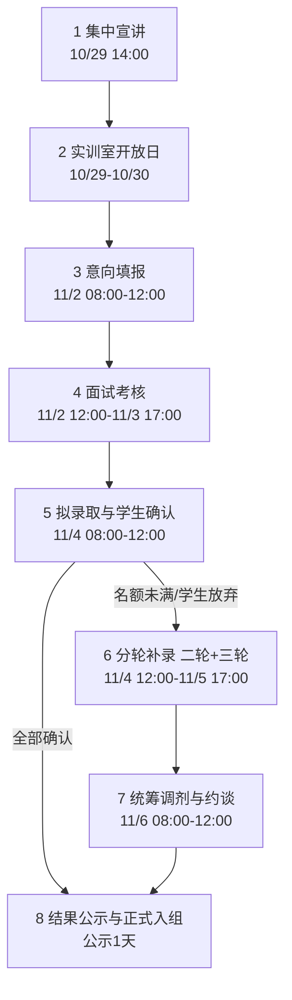

# 实训室选组选拔系统 项目需求说明书

> 依据《学生实训室选组选拔流程》流程图整理
> 核心设计原则：**双向选择 · 分轮录取 · 统筹调剂**

---

## 一、项目概述

### 1.1 背景
学院组织各实训室面向学生开展选组选拔。原流程依赖宣讲、走访、线下填报、集中面试和多轮补录，信息分散、名额与意向难以对齐。需建设一套线上系统，承载从宣讲触达到正式入组的全流程，保证时间节点刚性、名额准确、录取过程可追溯。

### 1.2 项目目标
1. 一条线上链路贯通 8 个阶段，学生与老师在同一系统中完成"选"与"被选"。
2. 名额、意向、录取数据实时一致，杜绝超录、重录、漏录。
3. 所有关键动作（填报、评分、定名单、确认、调剂、约谈）留痕可审计。
4. 最终产出：**正式入组名单**，学生进入实训室开展 AI+PBL 项目实训。

### 1.3 范围
- 纳入：宣讲信息发布、开放日预约/走访记录、意向填报、面试组织与评分、拟录取与确认、分轮补录、统筹调剂、公示与入组。
- 不纳入：实训室日常教学管理、项目过程考核、学生成绩管理（仅保留与选拔相关的考核要求字段）。

---

## 二、用户角色与权限边界

系统仅设 **学生**、**老师** 两个用户群体；老师群体内部按职责分为 **导师** 与 **实训室负责人** 两类，统筹类职责统一由实训室负责人承担。

### 2.1 学生（Student）

| 编号 | 能力 | 说明 |
|---|---|---|
| S-01 | 查看宣讲安排与实训室介绍 | 项目方向、招录名额、培养安排、考核要求 |
| S-02 | 报名参加开放日 / 查看走访安排 | 与导师、高年级学生交流 |
| S-03 | 填报平行意向 | 首轮最多 3 个，不分先后，可少于 3 个 |
| S-04 | 勾选调剂授权 | 分别授权"实训室内部调剂""全院跨实训室调剂" |
| S-05 | 查看面试安排与本人面试结果 | 面试时间、地点、拟录取/递补/未录取结论 |
| S-06 | 拟录取确认 | 收到 ≥2 个意向时自主选择唯一去向 |
| S-07 | 参与第二轮、第三轮补录填报 | 仅未录取学生可见入口，每轮仅 1 个意向 |
| S-08 | 查看公示名单、提出异议 | 公示期 1 天 |
| S-09 | 查看个人全流程进度 | 当前所处阶段与待办事项 |
| S-10 | 接收面试提醒并回执 | 面试前收到到场提醒（实训室、场次、时间、地点），可回执"已知晓" |

**学生数据可见性**：只能看到本人意向、本人面试结论、本人录取状态；可看各实训室公开的名额与已公布名单，不可见他人评分明细。

### 2.2 老师（Teacher）

| 子角色 | 职责 | 关键权限 |
|---|---|---|
| **导师（面试评委）** | 参与本实训室面试与评分 | 查看分配给本人的报名学生、按统一维度打分、提交评语；不可直接修改录取名单 |
| **实训室负责人** | 负责本实训室选拔组织，并承担学院层面的统筹职责 | 维护本室项目方向/名额/培养安排/考核要求；排定面试场次与评委；汇总评分生成拟录取、递补、内部调剂候选名单；执行内部调剂；发布阶段开关；公布剩余名额与组织补录；执行跨实训室调剂与三级统筹；约谈未服从调剂学生并记录结论；汇总最终名单、公示、处理异议、确认入组、导出名单 |

> 统筹职责（原学院教学管理员权限）全部归入实训室负责人。学院指定一名负责人承担全院统筹岗，负责跨实训室调剂、补录轮次控制与最终公示。

| 编号 | 能力 |
|---|---|
| T-01 | 维护实训室档案（方向、名额、培养安排、考核要求） |
| T-02 | 发布宣讲信息、开放日安排 |
| T-03 | 查看本室意向汇总（按导师/按学生） |
| T-04 | 组织面试：场次、评委、时间、地点 |
| T-05 | 按统一维度评分并提交（学习态度、逻辑思维、编程基础、时间投入） |
| T-06 | 生成拟录取名单、递补名单（有序）、内部调剂候选名单 |
| T-07 | 发起/接受内部调剂与跨实训室调剂 |
| T-08 | 公布剩余名额、组织补录面试与顺位递补 |
| T-09 | 约谈未服从调剂学生，在系统内记录约谈结论与最终安置结果 |
| T-10 | 控制各阶段开放/关闭，汇总最终名单、公示、处理异议、确认入组 |
| T-11 | 面试提醒管理：查看提醒送达与回执情况，对缺席学生决定是否补面并留痕 |

**老师说数据可见性**：导师可见本实训室范围内数据；实训室负责人可见本实训室全量数据；承担全院统筹岗的负责人可见全院数据。

---

## 三、核心业务对象

| 对象 | 关键字段 |
|---|---|
| 实训室 | 编号、名称、所属学院、项目方向、招录名额、培养安排、考核要求、状态 |
| 导师 | 工号、姓名、所属实训室、可带人数、研究方向 |
| 学生 | 学号、姓名、年级、专业、编程基础、可投入时间、联系方式 |
| 意向记录 | 学生、导师、实训室、平行序号(1~3，补录阶段固定为 1)、内部调剂授权、跨室调剂授权、提交时间、当前状态 |
| 面试场次 | 实训室、时间、地点、评委组、关联学生 |
| 面试评分 | 学生、意向、评委、四维度分值、总分、评语、排名 |
| 面试提醒 | 场次、学生、提醒时点、提醒渠道、送达状态、已读/回执、缺席处理结果 |
| 选拔结论 | 结论类型（拟录取/递补/内部调剂候选/不录取）、顺位、来源轮次 |
| 录取记录 | 学生、实训室、导师、来源（首轮/二轮/三轮/调剂）、确认方式（自动/手动）、确认时间、状态 |
| 约谈记录 | 学生、约谈人、约谈时间、约谈方式、学生意愿、约谈结论（接受安置/拒绝安置）、最终安置实训室 |
| 公示批次 | 批次号、公示起止时间、名单、异议记录、处理结果 |

---

## 四、主要业务链路

### 4.1 全链路时序

### 4.2 阶段明细

| 阶段 | 时间窗 | 学生动作 | 老师动作 | 系统动作 |
|---|---|---|---|---|
| 1 集中宣讲 | 10/29 14:00 | 查看宣讲 | 各室介绍方向/名额/培养安排/考核要求 | 发布宣讲内容与实训室档案 |
| 2 开放日 | 10/29—10/30 | 实地走访、交流 | 开放实训室，接待与答疑 | 记录走访/预约（可选） |
| 3 意向填报 | 11/2 08:00—12:00 | 最多 3 个平行意向 + 2 项调剂授权 | 实时查看报名情况 | 校验名额/重复/时间窗，提交后锁定 |
| 4 面试考核 | 11/2 12:00—11/3 17:00 | 按提醒到达实训室参加面试 | 以实训室为单位统一组织面试、评分 | 面试前定时推送到场提醒、生成拟录取/递补/内部调剂候选名单 |
| 5 拟录取确认 | 11/4 08:00—12:00 | 1 个意向自动确认；≥2 个自主选唯一去向 | 查看确认进度、处理放弃 | 自动确认、超时释放名额、按递补顺位补充 |
| 6 分轮补录 | 11/4 12:00—11/5 17:00 | 未录取学生重新填报（每轮 1 个意向）、参加面试 | 公布剩余名额、组织面试、双向确认、顺位递补 | 依次推动第二轮、第三轮，轮次隔离 |
| 7 统筹调剂 | 11/6 08:00—12:00 | 服从调剂者接受调剂；未服从者参加约谈 | 按三级优先级统筹安排，约谈并记录结论 | 归集调剂池、按优先级匹配、落库约谈记录 |
| 8 公示入组 | 公示 1 天 | 查看名单、提出异议 | 汇总名单、发布公示、处理异议、确认入组 | 公示无异议后置为"已入组" |

### 4.3 三条子链路

- **双向选择链路**：学生填意向 → 实训室统一面试 → 双方达成一致（学生愿意去 + 实训室愿意收）→ 录取成立。任一单向不成立，录取不成立。
- **名额补充链路**：名额未满 / 学生逾期放弃 → 递补名单按顺位补位 → 仍不足则进入补录轮次 → 仍不足则进入统筹调剂池。
- **兜底安置链路**：三轮补录后剩余名额 → 内部调剂 → 跨实训室调剂 → 约谈未服从调剂学生做最终统筹安置，并记录约谈结论，保证"人人有去向、名额不浪费"。

---

## 五、关键业务规则

### 5.1 时间与阶段控制

- **BR-01 时间窗软约束（2026-11-12 调整）**：阶段的时间窗仅作计划与提醒，不作为强制拦截条件；各阶段以负责人手动开启/关闭的轮次状态为准，可在任意时间自由进入下一阶段。系统时间仅用于展示与提醒推送。
- **BR-02 阶段不可跳跃**：前序阶段未结束（如面试未出结论），不得进入拟录取确认；实训室负责人（统筹岗）可手动提前开/关某一阶段，操作需留痕并记录原因。
- **BR-03 状态即开关**：填报窗口以轮次状态 `FILLING` 为准，负责人开启新轮次时自动收起其它填报中的轮次；轮次关闭后不再接受提交，不提供学生自助补录口子（例外须负责人操作并记录原因）。

### 5.2 意向填报

- **BR-04 平行意向数量**：首轮每名学生最多填报 3 个意向，可为 1~3 个；意向之间**不分志愿先后**，不设第一/第二志愿权重。补录阶段每轮**仅可填报 1 个意向**（见 BR-18）。
- **BR-05 意向去重**：同一学生对同一导师不得重复填报；**允许同一学生在同一实训室内选择多位不同导师**（如 3 个意向分别为实训室 A 的导师甲、导师乙、导师丙），也允许指向不同实训室。
- **BR-05a 导师容量仅约束录取**：意向填报阶段**不限制单个导师的选报人数**，学生可正常选择任一导师；导师的“可带人数”仅用于最终录取控制，即同一导师的有效录取记录（`OCCUPIED/CONFIRMED/EFFECTIVE/ENROLLED`）不得超过其容量，达上限后系统拒绝继续拟录取或调剂录取。
- **BR-06 调剂授权分离**：学生可自由选择“服从实训室内部调剂”或“服从全院跨实训室调剂”；未勾选即视为不服从，系统不得默认勾选。
- **BR-07 提交即锁定不可撤回**：意向提交后即锁定，学生不得撤回、不得修改，也不支持"撤回重填"；系统仅保留提交记录与时间。提交前需二次确认提示。

### 5.3 面试与评分

- **BR-08 全员必面**：无论某实训室报名人数是否达到名额，**所有报名学生均须参加面试**，不得免面直接录取，也不得因报名不足而跳过面试。
- **BR-09 组织主体**：面试**以实训室为单位统一组织**，由实训室负责人排定场次与评委组（评委为可选项，可先建场后补充），单个导师不得私自组织面试或私下承诺录取。
- **BR-10 统一评分维度**：评分固定四个维度——学习态度、逻辑思维、编程基础、时间投入；维度权重与分值区间全院统一，跨实训室可比。
- **BR-10a 评委与评分门槛（2026-11-12 调整）**：创建面试场次**不强制指定评委**，可先建场、后补充，评委人数不设硬性下限；拟录取只要求**至少 1 名评委提交有效评分**，不再依赖评分方案中的最少评委数。未指定评委时，本实训室导师、实训室负责人及统筹岗均可评分。
- **BR-11 名单三件套**：面试结束后，每个实训室必须同时产出三份有序名单——**拟录取名单**（≤ 本室名额）、**递补名单**（按顺位排序）、**内部调剂候选名单**（本室范围内可调剂人选）。

### 5.4 拟录取与确认

- **BR-13 自动确认**：学生仅收到 1 个拟录意向时，系统自动确认，学生无需操作。
- **BR-14 多意向自主选择**：收到 2 个及以上拟录意向的，须在12小时内自主选择唯一去向；选择完成后其余拟录意向自动失效并释放名额。
- **BR-15 逾期视为放弃**：窗口结束仍未确认的，系统判定为放弃，其占用的名额按该实训室递补顺位自动补充，并通知递补学生。
- **BR-16 名额硬约束**：任一实训室任一时刻"已确认人数 ≤ 招录名额"；拟录取名单总数不得超过名额，系统在生成、确认、补录、调剂四个节点均强校验。

### 5.5 补录与调剂

- **BR-17 补录参与资格**：仅"未录取"学生可参加补录；已录取（含自动确认、已手动确认）学生不得再填报，界面不展示补录入口。
- **BR-18 补录分轮且单意向**：第二轮与第三轮依次进行，每轮先公布剩余名额，再重新填报、统一面试、双向确认与顺位递补。**补录阶段每轮每名学生仅可填报 1 个意向**，填报后同样提交即锁定，不可撤回重填；上一轮结果锁定后才开启下一轮，轮次数据独立可查。
- **BR-19 调剂池归集**：三轮补录结束后，各实训室剩余名额统一归入学院调剂池，由承担全院统筹岗的实训室负责人统一处置，单个实训室不得自行分配。
- **BR-20 调剂优先级严格顺序**：① 实训室内部调剂 → ② 全院跨实训室调剂 → ③ 约谈未服从调剂学生并作最终统筹安置。**前一级未穷尽前不得进入下一级**，系统按序执行并记录每一级命中结果。
- **BR-21 调剂须经授权**：内部调剂只对勾选"服从内部调剂"的学生生效；跨实训室调剂只对勾选"服从全院跨实训室调剂"的学生生效；未授权学生进入第三级约谈。
- **BR-22 调剂仍受名额约束**：调剂进入某实训室同样占用该室名额，不得因"统筹"名义超录。
- **BR-23 约谈结果必须系统记录**：第三级约谈须在系统内登记约谈人、约谈时间、约谈方式、学生意愿与约谈结论（接受安置 / 拒绝安置）以及最终安置实训室；结论落库后学生状态同步更新。拒绝安置的学生标记为"最终未录取"并保留记录，未登记约谈结论的一律不得视为完成安置。

### 5.6 公示、入组与审计

- **BR-24 公示期**：最终名单公示 1 天，公示期内学生可提出异议；异议由实训室负责人（统筹岗）受理并给出处理结论，处理结果回写名单。
- **BR-25 公示无异议方可入组**：公示期满且无未决异议，学生状态转为"已正式入组"，进入 AI+PBL 项目实训；存在异议的个例单独挂起，不影响其余学生入组。
- **BR-26 全链路留痕**：意向提交、评分修改、名单调整、确认/放弃、调剂匹配、约谈记录、异议处理均记录操作人、时间、前后值，不可物理删除，只可追加更正记录。
- **BR-27 通知到人**：每个阶段开放与截止、面试安排与面试提醒、拟录结果、确认提醒、补录放号、约谈通知、公示发布，均需站内通知（可扩展短信/企业微信）。

### 5.7 面试提醒

- **BR-28 提醒时点与内容**：面试场次排定后，系统为每位参面学生自动生成提醒任务，至少覆盖**面试前 1 天**与**面试前 2 小时**两次。提醒内容须包含实训室名称、场次、面试时间、地点、需携带材料，并明确提示"请按时到实训室参加面试"。
- **BR-29 送达、回执与缺席**：提醒经站内通知下发（可扩展短信/企业微信），发送失败自动重试并记录失败原因，负责人可查看未送达名单；学生可在学生端回执"已知晓"。面试当天未签到者由系统标记为缺席，是否另行安排补面由实训室负责人决定并留痕。
- **BR-30 导师数据可见范围（2026-11-12 新增）**：在拟录取、学生确认与分轮补录环节，导师**只能看到选择自己的学生**及其意向、评分与录取进程，不得查看选择其他导师的学生；实训室负责人可看本室全部学生，统筹岗可看全院。越权发起拟录取将被拒绝并留痕。
- **BR-31 面试评委与操作权（2026-11-12 新增）**：面试场次排入学生时，系统**默认将该生所选导师登记为本场评委**；学生对某场次的签到、评分等操作，**仅其所选导师**可修改，其他导师（即使同为评委）不得改动；实训室负责人与统筹岗保留管理兜底权限。**导师提交的评分与评语可随时修改**，以“场次＋意向＋评委”为唯一记录覆盖更新，并保留修改留痕；修改后平均分、已评人数实时刷新，仅影响该导师本人的评分记录。
- **BR-32 面试场次撤销（2026-11-12 新增）**：实训室负责人/统筹岗可撤销尚未产生评分的面试场次；撤销后场次状态置为 `CANCELED` 留痕，排期学生、评委与待发提醒一并清除，学生可重新排期；已产生评分的场次不允许撤销；被撤销学生收到站内通知；**已撤销场次不再出现在场次列表与实训室统计中**。
- **BR-33 同场多意向排期（2026-11-12 新增）**：同一学生在同一实训室选择了多位导师时，这些意向可**同时排入同一场面试**，场次名单按意向逐条展示（含导师与意向序号）；参面记录、提醒均以“场次+意向”为唯一维度；签到/评分需携带意向 ID 精确定位，未指定且该生在本场次有多个意向时提示选择意向。
- **BR-34 排人即时提醒（2026-11-12 新增）**：学生被排入面试场次的**同时**，系统立即向该生发出站内“面试安排提醒”，内容含场次名称、面试时间、地点与“提前 10 分钟到场并携带学生证签到”提示；同一学生在同场次有多个意向时**只发一条**，避免重复打扰。该即时提醒与 BR-28 的“面试前 1 天 / 2 小时”定时提醒并行，排人结果返回本次实际通知人数并写入审计。
- **BR-35 轮次关闭时的拟录取确认（2026-11-12 新增）**：选报轮次关闭时，系统按学生统计其全部待确认（`OCCUPIED`）拟录取：**仅 1 个时自动确认**（`CONFIRMED`、`confirm_type=AUTO`，学生状态置 `CONFIRMED` 并收到通知）；**2~3 个时发送“拟录取待确认提醒”**，将确认截止设为**提醒发出后 30 分钟**，学生状态置 `PENDING_CONFIRM`。学生选择确认其中一个时，其余待确认记录自动释放；若 30 分钟内未确认，后台每分钟扫描到期记录，**自动释放其全部未确认名额**（状态 `RELEASED`），学生状态置 `SUPPLEMENT`（进入补录），并收到“已进入补录”站内通知。全过程写入审计。
- **BR-36 新一轮开放自动确认或释放未确认名额（2026-11-12 新增，2026-11-13 调整）**：统筹岗开启任意轮次时，对**此前轮次**（`round_no` 更小）中仍处于 `OCCUPIED` 的未确认拟录取按学生分组处理：**学生仅有 1 份拟录取时自动确认**（`status=CONFIRMED`、`confirm_type=AUTO`，学生状态置 `CONFIRMED`，收到“拟录取已自动确认”通知，审计 `ADMISSION_AUTO_CONFIRM`、`trigger=ROUND_OPEN`）；**有 2 份及以上时全部释放**，状态置 `RELEASED` 并写入名额回补流水，相关学生收到“上一轮拟录取已释放”通知，若已无其它活跃录取则状态置 `SUPPLEMENT`（进入补录）并收到“已进入补录”通知。开启结果返回 `released`、`autoConfirmed`、`autoConfirmedIds` 与 `supplementStudents`，全过程写入审计。
- **BR-37 新一轮开放撤销先前面试场次（2026-11-12 新增）**：统筹岗开启任意轮次时，系统自动撤销**此前轮次**（`round_no` 更小）中状态非 `CANCELED` 的面试场次：删除该场次的参面记录、评委与提醒，状态置 `CANCELED`，并向相关学生推送“面试场次已撤销”通知。为保留评分证据，**已产生评分的场次不撤销**（沿用 BR-32），通过返回的 `keptScoredSessionIds` 告知。开启结果返回 `canceledSessions`、`canceledSessionIds` 与 `keptScoredSessionIds`，并写入审计（`INTERVIEW_SESSION_CANCEL`，`trigger=ROUND_OPEN`）。
- **BR-38 统筹调剂覆盖全部未录取学生（2026-11-13 新增）**：统筹调剂轮次执行自动匹配时，候选范围以学生全表为基准，包含**所有尚无活跃录取**（`OCCUPIED`/`CONFIRMED`/`EFFECTIVE`/`ENROLLED`）**且本轮未生成调剂记录**的学生，不再要求其存在意向记录。有有效意向的学生按“内部调剂 → 跨实训室调剂 → 约谈”三级顺序匹配；**无有效意向的学生直接生成第三级约谈记录**（`priority_level=3`、`adjust_type=NEGOTIATED`、`status=PENDING`，备注“无有效意向，转第三级约谈”），由统筹岗通过约谈确定最终安置。
- **BR-39 调剂录取自动确认（2026-11-13 新增）**：凡通过统筹调剂产生的录取（内部调剂、跨实训室调剂、约谈确认）写入 `admission` 时即置 `status=CONFIRMED`、`confirm_type=AUTO`、`confirmed_at=NOW()`，`confirm_deadline` 为空；学生 `selection_state` 同步置 `CONFIRMED`，并收到“调剂录取已自动确认”通知。调剂录取**无需学生二次确认**，不参与 12 小时超时释放流程。为支持无有效意向学生的调剂结论，`selection_result.intent_id` 调整为可空。
- **BR-40 多次约谈与最终安置（2026-11-13 新增）**：同一学生同一轮次**允许多次约谈**，每次约谈均保留独立记录（`negotiation` 不再设 `(round_id, student_id)` 唯一约束）。约谈“拒绝”不作为终态，调剂记录保持 `PENDING`，可继续下一轮约谈；“接受”则完成安置（调剂记录 `MATCHED`）并自动确认录取。**统筹调剂轮次关闭前必须确保每名学生都已落实实训室**（存在活跃录取），否则拒绝关闭并提示未安置人数。
- **BR-41 自动调剂仅限统筹调剂轮次（2026-11-13 新增）**：自动调剂匹配只能安排在统筹调剂轮次（`round_type=ADJUST`）内执行：教师端“自动调剂匹配”的轮次下拉**仅列出统筹调剂轮次**并默认选中；后端对非 `ADJUST` 轮次返回 400“仅统筹调剂轮次可执行调剂匹配”。匹配产生的录取统一归属该统筹调剂轮次。
- **BR-42 学生自助注册（2026-11-13 新增）**：登录页提供“注册学生账号”，学生可凭 **学号（4-32 位字母或数字，注册后作为登录账号）+ 姓名 + 年级 + 专业 + 密码（≥6 位）** 自助开通账号，手机号可选填；注册成功即建立 `account(user_type=STUDENT)` 与 `student(selection_state=NOT_FILLED)` 记录、写入 `ACCOUNT_REGISTER` 审计，并直接返回登录态进入学生工作台。学号已存在（账号或学生档案）时返回 409“该学号已注册，请直接登录”。教师账号仍由教务统一开通，不开放自助注册。
- **BR-43 注册个人简历（2026-11-13 新增）**：注册表单在基本信息之外增加“个人简历”区块，包含 **年级排名（必填）**、获奖情况（可选，≤500 字）、擅长方向（可选，≤200 字）、意向发展方向（可选，≤200 字，与擅长方向同栏展示），分别存入 `student.grade_rank`、`student.awards`、`student.specialty`、`student.dev_direction`。年级排名需包含名次数字（如 `3` 或 `3/120`），为空或无数值时返回 400。教师端面试时可据此了解学生基本情况。
- **BR-44 实训室信息公开与编辑权限（2026-11-13 新增）**：学生端与教师端均新增“实训室信息”页，展示各实训室的 **主要方向、实训室简介、导师团队（职称、研究方向、个人简介）**。数据来源 `lab.direction/intro`（新增 `intro VARCHAR(1000)`）与 `teacher.intro`（新增 `VARCHAR(500)`）。权限规则：**学生仅可阅读**，接口 `GET /api/labs/profiles` 需登录，学生调用任何修改接口均返回 403；**教师可维护本人简介**（`PATCH /api/teachers/me/intro`，≤500 字）；**实训室负责人可维护本室主要方向与简介**（`PATCH /api/labs/{lab_id}/profile`，方向 ≤255 字、简介 ≤1000 字），全院统筹岗可维护全部实训室，非本室负责人操作返回 403。两类修改均写入审计（`TEACHER_INTRO_UPDATE` / `LAB_PROFILE_UPDATE`）。

---

## 六、状态模型

**意向状态**：草稿 → 已提交（锁定，不可撤回）→ 已面试 → 拟录取 / 递补 / 内部调剂候选 / 不录取 → 已确认 / 已放弃 / 已失效

**学生选拔状态**：未填报 → 待面试 → 待确认 → 拟录取（待公示）→ 已入组；旁支：未录取 → 补录中 / 待约谈 → 已入组 / 未录取（终态）

**录取记录状态**：预占（拟录取未确认）→ 已确认 → 已生效（公示通过）→ 已入组；异常态：已放弃、已释放

---

## 七、非功能性要求

1. **并发与峰值**：填报窗口仅 4 小时、确认窗口仅 4 小时，需支撑全院学生集中提交；提交接口需幂等，防重复提交。
2. **公平性**：平行意向无先后权重；评分维度与权重全院统一；调剂按预设优先级自动执行，不允许人工插队（人工干预须记录理由与操作人）。
3. **数据一致性**：名额扣减与释放采用事务或行锁，禁止出现"两个学生占同一名额""放弃后名额未释放"。
4. **可追溯**：任一录取结果可下钻到意向 → 面试评分 → 定名单 → 确认 → 调剂/约谈 的完整证据链。
5. **权限隔离**：学生仅见本人数据；导师仅见本室范围内数据；跨室调剂与全院名单仅统筹岗负责人可见。
6. **易用性**：移动端可用（学生多为手机操作），关键节点倒计时提示。

---

## 八、重点验收场景

| 场景 | 期望结果 |
|---|---|
| 学生只填 1 个意向并被拟录取 | 系统自动确认，无需学生操作 |
| 学生被 2 个实训室同时拟录取 | 学生只能确认 1 个，确认后另一名额立即释放给递补 |
| 学生提交后想修改意向 | 系统拒绝，提示"已提交不可撤回"，仅可查看提交记录 |
| 补录阶段学生填报 2 个意向 | 系统限制只能选 1 个 |
| 学生逾期未确认 | 判定放弃，名额按递补顺位补充，递补学生收到通知 |
| 某实训室报名人数少于名额 | 仍须全员面试，不得免面录取 |
| 学生未勾选任何调剂授权 | 不参与内部/跨室调剂，直接进入第三级约谈 |
| 约谈完成后未登记结论 | 系统不允许该生进入"已完成安置"状态 |
| 三轮补录后仍有剩余名额 | 归入调剂池，按"内部→跨室→约谈"顺序依次处理 |
| 已录取学生尝试参加补录 | 系统拦截，不展示补录入口 |
| 公示期内提出异议 | 名单挂起复核，其余学生正常入组 |
| 窗口关闭瞬间提交 | 以服务器时间为准，超时提交失败并明确提示 |
| 面试场次排定 | 系统按"前 1 天、前 2 小时"生成两次提醒，内容含实训室、时间、地点与按时到场提示 |
| 提醒发送失败 | 记录失败原因并自动重试，负责人可查看未送达名单 |
| 学生面试当天未签到 | 标记缺席，负责人可决定是否补面，处理结果留痕 |

---

## 九、待确认事项

1. 多评委计分规则：算平均 / 去极值平均 / 加权，权重是否公开。
2. "递补顺位"由总分排名生成还是由评委组合议确定。
3. 全院统筹岗负责人如何指定（固定一人 / 轮值），其跨室调剂权限是否需要二次确认。
4. 是否需要与学籍/教务系统对接（学生名单、专业、成绩）。
5. 面试提醒的提前时点（1 天 / 2 小时）与渠道（站内 / 短信 / 企业微信）是否按此设定。
